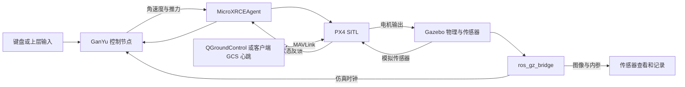

# Gazebo 单机无人机仿真与控制验证平台

基于 ROS 2 Humble、PX4 SITL 和 Gazebo Harmonic，面向终端控制接口适配、
自定义无人机控制器接入以及单机飞行任务验证。

## 项目来源

本项目在 [Eaglewzw（Verse）](https://github.com/Eaglewzw) 的
[Autonomous-Intercept-Drone](https://github.com/Eaglewzw/Autonomous-Intercept-Drone)
基础上进行本机环境适配与开发，保留原作者署名及上游代码来源。
原项目名称为 FPV-Intercept；本工作空间按照下述单机仿真与控制验证目标继续开发。

## 项目简介

当前工作空间为 `/home/ake/SJTU/适配终端/gazebo_sim`。
项目用于在可重复的仿真环境中，打通“状态反馈 → 上层指令/参考轨迹 → 自定义控制器
→ PX4 执行 → Gazebo 运动”的闭环，为后续机载终端与地面站控制接口提供验证基础。

当前已经接入的功能包括：

- **单机仿真环境**：Walls 障碍场景、独立 PX4 实例和仿真运行记录，提供原 `x500_depth`
  与新增的相机 + MID-360 机型 `x500_mid360`。
- **自定义控制器**：从本机 `sz_indoor_transport` 移植 `QuadrotorControllerGanYu`，
  根据位置、速度及姿态反馈计算总推力和角速度，使用 PX4 角速度内环执行。
- **键盘飞行操作**：按键触发起飞、空间位置目标调整、悬停与主动降落。
- **状态与传感器接口**：PX4 里程计、位置有效性、飞行状态、相机图像、相机内参和仿真时钟。
- **RViz2 显示**：同时显示 RGB 相机图像和 MID-360 仿真点云，并发布 ENU/FLU 可视化 TF。
- **日志与检查**：场景/数据就绪检查、控制状态和调试话题、PX4 ULog、参考跟踪测试记录。

后续开发方向是终端任务管理、航点任务、规划绕飞和地面站控制接口。
这些是后续目标，当前没有实现激光建图、自动避障或完整任务上传协议。
仓库内原有双机、视觉和制导代码作为历史资源保留，使用说明单独放在
[上游历史实验流程](docs/legacy_upstream_workflows.md)，不作为当前单机工作的启动步骤。

阅读入口：

- [环境依赖与编译](#快速上手)
- [方式一：使用现有脚本启动单机场景和键盘控制](#ganyu-quickstart)
- [方式二：逐项手动启动全部组件](#manual-start)
- [相机 + MID-360 新模型与 RViz2 显示](#rviz-sensors)
- [GanYu 按键、坐标和参考轨迹](#ganyu-keys)
- [GanYu 输入输出、移植差异和参数](#ganyu-controller)
- [当前降落行为与保留的检查](#ganyu-land-policy)
- [GanYu 接口、日志与问题排查](#ganyu-topics)
- [仿真环境组成与 PX4 目录](#simulation-architecture)
- [飞行控制链路](#flight-controller)
- [数据话题、订阅示例和控制接口](#vehicle-data)
- [Walls 场景几何布局](assets/gazebo_world/README.md)
- [GanYu 功能包说明](uav_ganyu_control/README.md)
- [官方文档学习路线](#official-docs)

## 快速上手

### 1. 环境依赖

- **ROS 2**：Humble。
- **Gazebo**：Harmonic（gz-sim 8；已有本机场景验证版本为 8.15.0）。
- **PX4**：v1.16.0，使用已有 `px4_sitl_default` 构建。
- **Micro-XRCE-DDS-Agent**：本机使用 v2.4.3，监听 UDP 8888。
- **编译工具**：C++17、CMake、colcon、Eigen3。
- **地面站连接**：GanYu 客户端可提供本机仿真心跳，也可连接 QGroundControl。

单机场景和 GanYu 还用到 `ros_gz_bridge`、Eigen3、`rclpy`、`px4_msgs`、
`rosgraph_msgs`、`std_msgs`，以及系统 Python 中的 Pillow、pymavlink。
场景、键盘和可视化入口会加载 ROS 2 和本工作空间环境，场景入口还会把 `~/.local/bin` 加入搜索路径。
直接执行 `ros2` 查看数据时，需要在该终端自行加载环境。

### 2. 编译项目

已有本机仿真环境和 `install/setup.bash` 时，仅重编译 GanYu 包：

```bash
cd /home/ake/SJTU/适配终端/gazebo_sim
source /opt/ros/humble/setup.bash
source install/setup.bash
colcon build --symlink-install --packages-select uav_ganyu_control \
  --cmake-args -DCMAKE_BUILD_TYPE=Release
```

尚未构建工作空间时，可先构建 GanYu 及其工作空间依赖：

```bash
cd /home/ake/SJTU/适配终端/gazebo_sim
source /opt/ros/humble/setup.bash
colcon build --symlink-install --packages-up-to uav_ganyu_control \
  --cmake-args -DCMAKE_BUILD_TYPE=Release
source install/setup.bash
```

如需同时构建仓库保留的其他实验包，应准备它们各自的额外依赖；全量构建命令为：

```bash
# 在本仓库根目录（即工作空间）编译
source /opt/ros/humble/setup.bash
colcon build --symlink-install
source install/setup.bash
```

修改 C++ 后需要重新编译并重新启动控制器进程；已运行的进程不会自动载入新二进制。
下文先给出脚本启动方式，再给出不依赖启动脚本的逐项手动方式，两者使用同一套单机配置。

<a id="ganyu-quickstart"></a>

### 3. 方式一：使用脚本启动 Walls 场景与 GanYu 键盘控制

当前实现包含一架 `x500_depth_1`、带碰撞体的四面障碍墙、RGB 相机数据、PX4 状态反馈，
以及从 `sz_indoor_transport` 移植的 `QuadrotorControllerGanYu`。
默认入口继续使用原相机模型；增加 `--mid360` 可选用带 MID-360 的新模型，见后面的 RViz2 章节。
地图构建、自动规划绕障和完整任务/地面站协议尚未接入。
该入口运行当前单机状态反馈、传感器和键盘控制链路。

#### 3.1 终端 1：启动场景

```bash
cd /home/ake/SJTU/适配终端/gazebo_sim
./run_obstacle_scene.sh
```

该脚本直接使用仓库内的 `assets/gazebo_world/walls_demo.sdf`，无需复制新地图到 PX4 目录。
它启动 Gazebo 服务端和 GUI、MicroXRCEAgent、一个 PX4 实例以及相机/时钟桥接，并检查数据。
关键配置如下：

- 世界名称 `walls_demo`；无人机在 Gazebo ENU 原点 `(0, 0, 0)` 生成。
- 机型 `gz_x500_depth`，`PX4_SYS_AUTOSTART=4002`，PX4 实例编号 `1`。
- ROS 命名空间 `/px4_1`，命令目标系统 ID `2`；新场景没有 `/px4_2`。
- 不加 `--mid360` 时沿用原 x500 相机模型；`--mid360` 才加载新增雷达和相应桥接。
- 新入口显式使用 `EKF2_HGT_REF=1`，即 GPS 高度参考；旧入口的设置仍保留在原脚本中。
- PX4 工作目录、参数和 ULog 按次保存到 `log/obstacle_scene/<时间>_<后缀>/px4/`。

看到 `READY` 表示四面墙、无人机、有效位置/里程计、图像、相机内参和推进的时钟均已检查。
它不代表 PX4 所有预检已经通过。此时无人机保持未解锁，场景脚本不会自动起飞。
保持该终端运行。

其他启动方式：

```bash
# 不打开 GUI，保持仿真运行，可在另一终端接入键盘控制
./run_obstacle_scene.sh --headless

# 不打开 GUI；只做场景及数据检查，成功后退出本次仿真
./run_obstacle_scene.sh --headless --check

# 将数据就绪等待时间从默认 90 秒延长到 120 秒
./run_obstacle_scene.sh --timeout 120
```

PX4 默认目录为 `~/PX4-Autopilot`，可通过环境变量 `PX4_DIR` 指定已有构建的其他目录。
新入口检测到已有 PX4、Gazebo 世界、重复运行锁或被占用的 Agent UDP 8888 时会拒绝启动。
退出已有场景应在其所属终端操作；新脚本不负责终止其他仿真实例。

#### 3.2 终端 2：启动 GanYu 与键盘

```bash
cd /home/ake/SJTU/适配终端/gazebo_sim
./run_ganyu_keyboard.sh
```

该入口启动 `/ganyu_controller` 和 `/ganyu_keyboard`。启动后不会自行解锁；
终端显示“就绪”后按 `t`，无需回车。状态按以下顺序推进：

```text
IDLE → PRESTREAM → WAIT_OFFBOARD → WAIT_ARM → ACTIVE
```

- `IDLE`：等待起飞操作；`t` 仅在该阶段且未解锁时生效。
- `PRESTREAM`：先持续发送 body-rate 模式心跳和零推力设定值，等待超过 1.5 秒仿真时间。
- `WAIT_OFFBOARD`：请求 PX4 进入 Offboard，并等待状态确认。
- `WAIT_ARM`：等待 `pre_flight_checks_pass=true` 后请求解锁，并等待解锁确认。
- `ACTIVE`：开始由 GanYu 跟踪参考轨迹；默认用 5 秒仿真时间从当前点升至起飞点上方 1.5 m。

界面“就绪”只表示位置、里程计、时钟和状态反馈满足新鲜度检查，不等于飞控预检通过。
若停在 `WAIT_ARM`，应查看 PX4 预检提示。当前已删除阶段超时自动降落，
节点会继续等待；`x` 或 `Ctrl+C` 可以取消等待并退出。

键盘客户端默认尝试占用 UDP 14550 并发送 1 Hz MAVLink 地面站心跳。
若已有 QGroundControl 占用该端口，客户端不启动自己的地面站心跳，保留已有连接。
使用真实地面站时也可以显式关闭内置心跳：

```bash
./run_ganyu_keyboard.sh --external-gcs
```

`--external-gcs` 必须放在 `--ros-args` 前面，只关闭内置 MAVLink 心跳，
不会关闭 `/ganyu/keyboard_alive`。内置心跳只提供连接存活信息，不包含地面站界面或任务功能。

<a id="ganyu-keys"></a>

#### 3.3 按键、坐标与参考轨迹

保持键盘终端获得焦点，使用英文字母。移动方向基于 PX4 本地 NED 世界坐标，
不随机头转动：`x` 向北、`y` 向东、`z` 向下。

- `t`：请求起飞，默认目标相对高度 1.5 m。
- `w / s`：目标分别向北 / 南增加 0.25 m。
- `a / d`：目标分别向西 / 东增加 0.25 m。
- `e / q`：目标分别上升 / 下降 0.25 m。
- `空格`：将当前反馈位置设为目标，再通过参考轨迹平滑过渡；不是瞬间清零速度。
- `l`：主动请求 PX4 LAND，键盘终端继续运行，落地上锁后返回 `IDLE`。
- `x` 或 `Ctrl+C`：先请求降落/取消待起飞流程，等待新状态确认 `IDLE` 且未解锁后退出。
  客户端最多等待 45 秒，超时会报告未确认并退出。

上述数值为默认值。终端帮助文字固定显示默认高度和步长；传入自定义参数后，
以控制节点实际参数和 `Target N/E/up` 日志为准。

每次按键修改的是“最后的目标点”，不是飞机当前位置，也不是速度指令。
例如，默认起飞稳定后按两次 `w`、一次 `d`、一次 `e`，最终相对目标为
北 0.50 m、东 0.25 m、高 1.75 m。长按会产生系统按键重复，连续累加目标；
松开后保持最后目标，切换窗口本身不会触发降落。

目前仍保留这些边界和轨迹设置：

- 水平目标限制为本次 `t` 捕获的起飞点南北、东西各 ±3 m。
- 高度目标限制为该点上方 0.5～3 m；该限制不是地形跟随高度。
- 起飞使用 5 秒参考段；移动和空格使用 2 秒七次多项式参考段。
- 重设目标时保留参考位置、速度、加速度及 jerk 的连续性。
- 没有单独的速度、加速度或 jerk 上限；连续长按、快速反向和边界处重复按键仍会重设轨迹。

目标边界不保证实际位置或中间参考轨迹始终处于范围内。删除自动降落条件没有改变
上述轨迹生成行为，也没有加入碰撞检测或自动绕障。
Gazebo 世界采用 ENU（东、北、上），与 PX4 NED 的轴方向不同，本地原点也可能存在偏移。

#### 3.4 正常结束与重新运行

先在键盘终端按 `l` 或 `x`，或用 `Ctrl+C` 请求降落；观察 `LANDING → IDLE` 和未解锁状态。
`l` 可保留当前键盘会话；`x`、`Ctrl+C` 会结束键盘和本次启动的控制器。
随后在场景终端按 `Ctrl+C`，关闭该入口创建的仿真进程，日志会保留。

键盘客户端收到 `SIGTERM` 时也进入同一退出流程。若客户端无法在 45 秒内确认结束，
入口仍会退出并停止控制节点，此后由 PX4 根据自身状态和配置处理。
只关闭键盘入口不会关闭场景。更新 C++ 后，重新执行 `./run_ganyu_keyboard.sh` 才会使用新版本。

<a id="ganyu-controller"></a>

#### 3.5 GanYu 的输入输出与移植范围

控制核位于 [ganyu.hpp](uav_ganyu_control/include/uav_ganyu_control/ganyu.hpp)，
ROS 接入与状态机位于 [ganyu_controller.cpp](uav_ganyu_control/src/ganyu_controller.cpp)，
键盘客户端位于 [keyboard.py](uav_ganyu_control/scripts/keyboard.py)。
来源是本机 `sz_indoor_transport` 的
`src/sz_indoor_controller/include/sz_indoor_controller/custom/quadrotor_ganyu.h`，
参考提交为 `214d185c2f5658dca4e630ff1fc9027f4daf8c9d`；原 ROS 1 源文件未修改。

每个控制步的输入包括：

- 当前状态：NED 位置 `p`（m）、NED 速度 `v`（m/s）、FRD 机体系到 NED 的旋转矩阵 `R`。
  状态来自 PX4 `VehicleOdometry`；若速度字段为 BODY_FRD，接入层先转换到 NED。
- 参考状态：位置、速度、加速度、jerk，分别为 m、m/s、m/s²、m/s³，由键盘参考生成器提供。
- 仿真时间步长 `dt` 与起飞时捕获的偏航参考。

输出为总推力 `T`（N）和机体系角速度 `omega`（rad/s）。计算先根据位置、速度误差和积分
形成期望力，再根据期望推力方向及其变化率生成角速度。
接入层将结果转换为 `VehicleRatesSetpoint`，`thrust_body=[0,0,-u]`，
其中 `u` 为归一化推力输入；`roll/pitch/yaw` 字段表示三个轴的角速度。
当前链路如下：

```text
键盘目标 → 七次参考轨迹 → GanYu：总推力 + 角速度
  → VehicleRatesSetpoint + OffboardControlMode.body_rate
  → PX4 mc_rate_control → control_allocator → Gazebo 电机/机体
  → 模拟传感器 → PX4 EKF → VehicleOdometry → GanYu
```

GanYu 承担外部位置反馈到推力和角速度的控制计算；此路径使用 PX4 的角速度内环和控制分配。
节点不发布 `TrajectorySetpoint` 或 `VehicleAttitudeSetpoint`。
控制定时器周期为 5 ms（200 Hz），参考推进依赖 `/clock`；实际角速度发布频率还受时钟和计算影响。
消息时间戳沿用节点 ROS 时钟的微秒值，参考轨迹单独使用订阅到的仿真时间。

移植时作出的调整目前仍保留：

- 质量由原 `myparams.json` 的 0.207 kg 改为当前模型各 link 之和约 2.125307692 kg；
  这里只改变控制器参数，没有改写模型质量。
- 推力上限由原配置 20 N 改为 30 N；位置/速度/积分增益分别为三轴 9.75、3.6、0.5，
  `kr=120`、`hr=30`，积分分量限幅 ±5，重力常数 9.81 m/s²。
- 固定偏航目标 1.57 rad 改为起飞时航向，并对偏航误差作角度回绕。
- 时间步长从 ROS 1 内部取时改为显式传入，计算核保留 0.0001～0.05 s 的步长限幅。
- 不沿用原 MAVROS 发送层的 X/Y 交换和原机多项式标定，按当前 NED/FRD 接口直接发送。
- 输出横滚/俯仰角速度限制为 ±1 rad/s，偏航角速度限制为 ±0.5 rad/s。

推力映射使用当前 X500 模型的单电机常数 `k=8.54858e-6`、转速范围 150～1000 rad/s：

```text
speed = sqrt(T / (4 * k))
signal = clamp((speed - 150) / 850, 0, 1)
u = factor * signal² + (1 - factor) * signal
```

`factor` 对应需要匹配的 PX4 `THR_MDL_FAC`，本机验证值为 0；默认质量下悬停输入约 0.742。
该总推力换算基于等转速稳态关系，姿态修正时为近似。节点不会自动读取或写入 PX4 电机参数。

可通过启动参数覆盖的项目为：

- `px4_namespace=/px4_1`、`target_system=2`：PX4 话题前缀和命令目标系统 ID。
- `takeoff_height=1.5`：起飞相对高度，当前接受 0.5～3 m。
- `keyboard_step=0.25`：每次按键增量，当前接受大于 0 且不超过 0.5 m。
- `mass=2.125307692307692`、`max_thrust=30.0`：质量和总推力上限。
- `motor_constant=8.54858e-6`、`motor_speed_min=150.0`、`motor_speed_max=1000.0`。
- `thrust_model_factor=0.0`：上述推力映射中的 factor。

例如，用 2 m 起飞高度和 0.1 m 按键步长启动：

```bash
./run_ganyu_keyboard.sh --ros-args \
  -p takeoff_height:=2.0 -p keyboard_step:=0.1
```

这些参数在构造节点时读取，修改后需重启控制器；不是在线调参接口。
增益、角速度限幅、±3 m / 0.5～3 m 目标边界以及 2 秒/5 秒参考时间当前为代码中的固定值，
未提供对应 ROS 参数。`px4_namespace` 和 `target_system` 应与实际实例同时匹配。

<a id="ganyu-land-policy"></a>

#### 3.6 当前降落行为：附加自动条件已删除

**当前 GanYu 节点不会因为下面这些条件主动发出 LAND：**

- 倾角超过原先设置的 35°。
- 里程计或位置反馈超过原先设置的 0.3 秒未更新。
- 仿真时钟超过 0.5 秒未更新，或飞控状态超过 3 秒未更新。
- 键盘存活心跳超过 2 秒未更新。
- Offboard、解锁等阶段等待超过 15 秒。
- 仿真时间倒退，或一次控制步的仿真时间增量超过 0.5 秒。
- EKF 重置时位置跳变超过 0.25 m 或姿态跳变约 5°。
- 控制计算抛出异常或产生非有限输出。

现在这些情况的具体处理是：

- 反馈变旧或键盘心跳中断不会触发节点降落；有正向仿真时间增量时，继续使用最后接收的有效状态计算。
- 仿真时间未前进或倒退时不执行该步控制计算，但继续发送 Offboard 模式心跳。
- EKF 重置计数变化时清除积分，保留参考目标，不再区分大小跳变来决定降落。
- 控制计算异常时限频记录 `GanYu computation error`，不发布该次无效控制量，继续发送模式心跳。
- 节点自身的降落请求来自 `l`、`x`，以及键盘客户端的 `Ctrl+C` / `SIGTERM` 退出流程。

**起飞前检查仍保留。** 按 `t` 时仍要求位置有效、里程计/位置更新间隔小于 0.3 秒、
时钟更新间隔小于 0.5 秒、状态更新间隔小于 3 秒、键盘心跳间隔小于 1 秒，
并检查其他控制发布者；解锁前仍等待 PX4 预检通过。这里的阈值只用于判断起飞准备状态，
不会在飞行中自动发 LAND。非法坐标系、无效四元数和非有限状态的输入过滤也保留。

**PX4 自身的保护参数没有改动。** 外部节点退出、通信中断或飞控自身检测到故障时，
PX4 仍按自己的配置处理，不能据此认为任何情况下都不会发生降落或模式切换。
人工切换出 Offboard 后，节点进入 `YIELDED` 并停止输出，不会自动抢回控制权。

<a id="ganyu-topics"></a>

#### 3.7 ROS 接口、状态、日志与排查

GanYu 使用的 PX4 输出包括 `/px4_1/fmu/out/` 下的
`vehicle_odometry`、`vehicle_local_position`、`vehicle_status_v1`、
`vehicle_land_detected` 和 `vehicle_command_ack`，订阅采用传感器 QoS。
控制输入为该实例 `/fmu/in/` 下的 `offboard_control_mode`、`vehicle_rates_setpoint`、`vehicle_command`。

上层键盘/状态接口为：

- `/ganyu/keyboard`，`std_msgs/msg/String`：单个按键字符，如 `t`、`w`、`l`。
- `/ganyu/keyboard_alive`，`std_msgs/msg/Empty`：客户端按 10 Hz 发送的存活消息。
- `/ganyu/status`，`std_msgs/msg/String`：约 5 Hz 的 JSON 状态。
- `/ganyu/control_debug`，`std_msgs/msg/Float64MultiArray`：约 20 Hz 的控制与参考调试数组。

`status` 包括 `phase`、`ready`、`preflight`、`armed`、`landed`、`nav_state`、
`position_ned`、`target_ned`、`offset_neu`、`thrust_N` 和 `throttle`。
`offset_neu` 是相对于本次捕获起飞点的北/东/上偏移；`ready` 是反馈准备状态，
`preflight` 才是 PX4 预检标志。`thrust_N` 和 `throttle` 是最后一次计算输出，
进入降落或空闲后可能仍显示旧值，不应解释为当前实际电机输出。

`control_debug` 共 26 项，索引依次为：0 总推力、1 归一化推力、2～4 角速度、
5～7 参考位置、8～10 参考速度、11～13 参考加速度、14～16 参考 jerk、
17～19 积分、20～22 当前位置、23～25 当前速度。
这些接口可供后续上层软件适配；当前未实现 `MissionGoal`、任务上传或独立网络地面站 API。

在另一个终端查看状态和日志。下面两个日志路径对应脚本启动；手动启动的日志路径见第 4.10 节：

```bash
cd /home/ake/SJTU/适配终端/gazebo_sim
source /opt/ros/humble/setup.bash
source install/setup.bash
ros2 topic echo /ganyu/status --once
ros2 topic echo /px4_1/fmu/out/vehicle_status_v1 \
  px4_msgs/msg/VehicleStatus --qos-reliability best_effort --once
ros2 topic echo /px4_1/fmu/out/vehicle_local_position \
  px4_msgs/msg/VehicleLocalPosition --qos-reliability best_effort --once
tail -n 80 log/ganyu_control/latest/controller.log
tail -n 80 log/obstacle_scene/latest/px4.log
```

新场景还桥接 `/clock`、`/camera/image`、`/camera/camera_info`，本机验证 RGB 为 1920×1080。
默认入口没有点云，`--mid360` 入口额外桥接 `/lidar/points`；当前没有额外桥接深度图。
重新检查默认场景时，可在上述已加载环境的终端执行：

```bash
/usr/bin/python3 scripts/check_obstacle_scene.py --output log/obstacle_scene/latest
```

运行日志按次保存，`latest` 为最近一次运行的符号链接：

- `log/obstacle_scene/<时间>_<后缀>/`：Gazebo、GUI、Agent、PX4、桥接日志、
  `verification.json`、相机快照和独立的 `px4/` 目录。
- `log/ganyu_control/<时间>_<后缀>/`：控制器日志和进程编号。
- `log/ganyu_control/keyboard_validation_final/`：原小步键盘试飞的记录。

常见现象的含义：

- **启动后不飞**：新入口默认未解锁，需要按 `t`；这与原位置键盘节点启动即请求解锁的行为不同。
- **`Takeoff rejected`**：按 `t` 时数据/心跳未就绪，或有其他设定值发布者；恢复条件后重新按 `t`。
- **停在 `WAIT_OFFBOARD` / `WAIT_ARM`**：查看 ACK 和 PX4 预检日志；当前不会因等待 15 秒而自动降落。
- **删除条件后仍看到 `Excessive tilt`**：检查日志时间及是否仍运行旧进程；历史日志不会被自动删除，
  旧二进制需要退出后重新编译、启动。
- **长按后速度或倾角较大**：当前参考生成仍没有独立的速度/加速度上限，删除降落分支没有修正这一行为。
- **`Another ... session is running` 或端口占用**：在原会话所属终端结束对应进程，再启动新会话。
  新场景入口会自行启动 MicroXRCEAgent，无需另开终端再次运行 Agent。
  如果提示 `UDP 8888 is in use`，可用 `ss -lunp 'sport = :8888'` 查看占用者；
  确认所属仿真已结束后，只停止对应的残留 Agent，再重启场景。
- **人工切换模式后键盘不再驱动飞机**：检查是否处于 `YIELDED`；该阶段不会自动重新进入 Offboard。

本机验证记录（2026-10-25）：GanYu 的 500 组源码公式对照在匹配参数和偏航条件下通过；
原小步键盘试飞完成起飞、移动、悬停、降落，全程参考跟踪 RMSE 约 0.018 m。
该试飞发生在删除附加降落条件之前，未覆盖持续长按和连续快速反向，不能代表这些操作已经验证稳定。
删除条件后，重新编译及 14 项隔离 ROS 回归检查通过，覆盖超时、大倾角、EKF 跳变、
时钟跳变、数值异常不发 LAND，以及主动降落仍有效；该回归使用模拟 PX4 消息，
不等同于新一轮 Gazebo 动力学试飞。

<a id="manual-start"></a>

### 4. 不使用启动脚本，逐项手动启动

本节不执行 `run_obstacle_scene.sh`、`run_ganyu_keyboard.sh` 或 `run_swarm.sh`，
而是逐个启动同一套组件，使用相同的机型、实例、话题和控制参数。
先完成前面的编译步骤，并结束其他占用同一世界、PX4 实例或端口的仿真会话。
脚本方式与手动方式选择一套运行，不要叠加启动。

整体顺序为：

```text
Agent → Gazebo 服务端 → Gazebo GUI（可选）→ PX4
  → 相机/时钟桥接 → 数据检查 → GanYu 控制节点 → 键盘客户端 → 按 t 起飞
```

各长期运行的组件分别占用一个前台终端，保持它们运行，再打开下一个终端。
数据检查结束后，可以复用该终端启动控制器；带 GUI 时共需 7 个长期运行的终端。
手动方式不提供脚本中的重复运行锁和统一清理，各组件由你启动和结束；同一架飞机只保留一套控制节点。

#### 4.1 每个新终端先加载公共环境

**以下每个步骤使用的新终端，都先执行这段命令，然后再执行该步骤的命令。**
终端之间不会自动共享后来设置的变量，因此后面共享运行目录采用文件系统中的 `latest` 链接。

```bash
cd /home/ake/SJTU/适配终端/gazebo_sim
export PATH="$HOME/.local/bin:$PATH"
source /opt/ros/humble/setup.bash
source install/setup.bash
source "$HOME/PX4-Autopilot/build/px4_sitl_default/rootfs/gz_env.sh"
```

前两份 setup 文件加载 ROS 2 及当前工作空间；`gz_env.sh` 加载 PX4 模型路径、Gazebo 插件路径和服务端配置。
如果 PX4 放在其他目录，本节所有 `~/PX4-Autopilot` 路径应一起修改。
所有组件应使用一致的 ROS 通信域和 Gazebo partition；没有自行设置这些变量时使用默认配置即可。

可先在准备终端确认命令和程序存在：

```bash
command -v gz MicroXRCEAgent ros2
test -x "$HOME/PX4-Autopilot/build/px4_sitl_default/bin/px4"
ros2 pkg executables uav_ganyu_control
ss -lunp 'sport = :8888'
```

GanYu 可执行列表应包含 `ganyu_controller` 和 `ganyu_keyboard`。
如果 UDP 8888 已被确认可复用的 Agent 占用，保留它并跳过下面的 Agent 启动；
如果是已经结束的旧仿真留下的进程，先确认归属，再结束对应进程。

#### 4.2 终端 1：启动 MicroXRCEAgent

执行公共环境命令后运行：

```bash
MicroXRCEAgent udp4 -p 8888
```

Agent 保持前台运行，监听 PX4 的 UDP 8888 连接。PX4 尚未启动时，没有客户端连接是正常现象。
后面 PX4 接入后，应能看到客户端及 publisher/subscriber 等实体创建的日志。
同一个端口只启动一个 Agent。

#### 4.3 终端 2：启动 Gazebo 服务端和 Walls 世界

执行公共环境命令后运行：

```bash
gz sim -r -s -v 3 "$PWD/assets/gazebo_world/walls_demo.sdf"
```

`-s` 启动服务端，`-r` 让仿真直接运行。此时世界中已有地面和四面墙；
无人机要到后面的 PX4 步骤才会生成，因此暂时看不到飞机是正常的。

没有桌面显示或使用无界面渲染时，将这一条替换为：

```bash
gz sim -r -s --headless-rendering -v 3 "$PWD/assets/gazebo_world/walls_demo.sdf"
```

两条服务端命令只选一条执行。无界面方式仍需要相机渲染，后面的图像检查也会继续使用。

#### 4.4 终端 3：启动 Gazebo GUI，可选

执行公共环境命令后运行：

```bash
gz sim -g --gui-config "$PWD/assets/gazebo_world/walls_demo.gui.config"
```

GUI 连接已经运行的服务端，使用本项目的俯瞰视角配置。
如果只做无界面仿真，可以跳过整个步骤，不影响 PX4、控制器和 ROS 数据链路。

#### 4.5 终端 4：启动单个 PX4 SITL 实例

执行公共环境命令后，创建本轮独立工作目录并启动 PX4：

```bash
px4_dir="$HOME/PX4-Autopilot"
mkdir -p "$PWD/log/manual_scene"
manual_run_dir=$(mktemp -d "$PWD/log/manual_scene/$(date +%Y%m%d_%H%M%S)_XXXX")
mkdir "$manual_run_dir/px4"
ln -sfn "$manual_run_dir" "$PWD/log/manual_scene/latest"
printf '本轮手动运行目录：%s\n' "$manual_run_dir"

env PX4_GZ_STANDALONE=1 \
  PX4_GZ_WORLD=walls_demo \
  PX4_SYS_AUTOSTART=4002 \
  PX4_SIM_MODEL=gz_x500_depth \
  PX4_GZ_MODEL_POSE=0,0,0 \
  PX4_PARAM_EKF2_HGT_REF=1 \
  "$px4_dir/build/px4_sitl_default/bin/px4" \
  -d -i 1 -w "$manual_run_dir/px4" \
  "$px4_dir/build/px4_sitl_default/etc"
```

这里各参数的作用为：

- `PX4_GZ_STANDALONE=1`：连接已启动的 Gazebo，不再由 PX4 额外启动世界。
- `PX4_GZ_WORLD=walls_demo`：匹配世界名；它是 SDF 中的世界名称，不是完整文件路径。
- `PX4_SYS_AUTOSTART=4002` 与 `PX4_SIM_MODEL=gz_x500_depth`：选择当前带相机的 x500 模型。
- `PX4_GZ_MODEL_POSE=0,0,0`：模型在 Gazebo ENU 世界原点生成。
- `PX4_PARAM_EKF2_HGT_REF=1`：与现有单机入口一致，使用 GPS 高度参考。
- `-i 1`：PX4 实例编号为 1，对应 `/px4_1`，当前默认命令目标系统 ID 为 2。
- `-w`：本轮 PX4 参数、dataman 和 ULog 使用独立目录，不复用旧运行数据。

启动后 GUI 中应出现 `x500_depth_1`。保持此终端运行；预检是否通过要结合状态消息判断，
没有地面站心跳时可以先继续后面的步骤，键盘客户端启动后会尝试提供心跳。
此命令本身不会解锁或起飞。

#### 4.6 终端 5：桥接仿真时钟、RGB 图像和相机内参

执行公共环境命令后运行：

```bash
bridge_yaml="$PWD/log/manual_scene/latest/bridge.yaml"
cat > "$bridge_yaml" <<'YAML'
- ros_topic_name: /clock
  gz_topic_name: /world/walls_demo/clock
  ros_type_name: rosgraph_msgs/msg/Clock
  gz_type_name: gz.msgs.Clock
  direction: GZ_TO_ROS
- ros_topic_name: /camera/image
  gz_topic_name: /world/walls_demo/model/x500_depth_1/link/camera_link/sensor/IMX214/image
  ros_type_name: sensor_msgs/msg/Image
  gz_type_name: gz.msgs.Image
  direction: GZ_TO_ROS
- ros_topic_name: /camera/camera_info
  gz_topic_name: /world/walls_demo/model/x500_depth_1/link/camera_link/sensor/IMX214/camera_info
  ros_type_name: sensor_msgs/msg/CameraInfo
  gz_type_name: gz.msgs.CameraInfo
  direction: GZ_TO_ROS
YAML

ros2 run ros_gz_bridge parameter_bridge --ros-args \
  -p "config_file:=$bridge_yaml"
```

该配置与场景启动脚本使用的三项桥接一致，方向均为 Gazebo 到 ROS。
PX4 里程计、状态和控制命令通过 Agent 的 DDS 链路传输，不通过这份 YAML。
若创建 YAML 时提示目录不存在，说明第 4.5 步的运行目录还没有创建成功。

#### 4.7 数据检查：使用一个临时终端

执行公共环境命令后，运行只读检查：

```bash
/usr/bin/python3 scripts/check_obstacle_scene.py \
  --timeout 90 --output log/manual_scene/latest
```

这是数据检查工具，不会启动其他组件，也不会发送解锁或飞行指令。
成功时输出 `passed: true`，并在本轮目录保存 `verification.json` 和 `camera.png`。
检查覆盖四面墙、无人机实体、推进的仿真时间、有效位置/里程计、图像和相机内参。
检查通过不等于 PX4 预检通过，二者分别记录。

也可以用 ROS 命令逐项查看：

```bash
ros2 topic list
ros2 topic echo /clock rosgraph_msgs/msg/Clock \
  --qos-reliability best_effort --once
ros2 topic echo /px4_1/fmu/out/vehicle_local_position \
  px4_msgs/msg/VehicleLocalPosition --qos-reliability best_effort --once
ros2 topic echo /px4_1/fmu/out/vehicle_status_v1 \
  px4_msgs/msg/VehicleStatus --qos-reliability best_effort --once
ros2 topic echo /camera/camera_info sensor_msgs/msg/CameraInfo \
  --qos-reliability best_effort --once
```

其中位置应具有 `xy_valid: true`、`z_valid: true`，时钟应持续推进。
起飞前通常仍是 `arming_state: 1`（未解锁）；按 `t` 后成功进入控制时应为
`arming_state: 2`、`nav_state: 14`。
检查失败时先查看对应组件的前台日志，再继续启动控制器。

#### 4.8 终端 6：单独启动 GanYu 控制节点

可以复用上一步检查终端；若新开终端，先执行公共环境命令。

```bash
ros2 run uav_ganyu_control ganyu_controller --ros-args \
  -p px4_namespace:=/px4_1 -p target_system:=2 \
  2>&1 | tee log/manual_scene/latest/ganyu_controller.log
```

该命令只启动控制器，没有启动键盘，也没有提供客户端地面站心跳。
节点仍等待键盘指令，不会自行起飞。此终端的输出同时写入本轮控制日志。
需要改变起飞高度或步长时，可以在命令的 `--ros-args` 参数部分追加
`-p takeoff_height:=2.0 -p keyboard_step:=0.1`，其他参数见前面的 GanYu 参数说明。

#### 4.9 终端 7：单独启动键盘客户端

执行公共环境命令后运行：

```bash
ros2 run uav_ganyu_control ganyu_keyboard
```

在这个终端保持键盘焦点，看到反馈“就绪”后按 `t`，然后使用前文说明的移动、悬停和降落按键。
默认客户端会发送本机 MAVLink 地面站心跳。如果已经使用 QGroundControl，
可以将上一条命令替换为：

```bash
ros2 run uav_ganyu_control ganyu_keyboard --external-gcs
```

两条键盘命令只选一条。当前节点不会因为启动顺序本身自动起飞，必须由键盘发起 `t`。

#### 4.10 手动启动时的退出和日志

手动方式没有脚本统一管理进程，退出顺序也要手动完成：

1. 在键盘终端按 `l` 降落，或按 `x` / `Ctrl+C` 请求降落并退出键盘。
2. 确认节点回到 `IDLE` 且飞机未解锁后，在控制器终端按 `Ctrl+C`。
3. 依次在桥接、PX4、GUI、Gazebo 服务端的终端按 `Ctrl+C`。
4. 最后结束本次手动启动的 Agent；若 Agent 是复用的其他会话服务，按其原有用途保留。

**手动启动时，退出键盘客户端不会自动结束另一个终端中的控制器。**
这与 `run_ganyu_keyboard.sh` 统一启动、退出两个进程的行为不同。
同样，关闭 GUI 不等于停止 Gazebo 服务端，退出 PX4 也不会替你结束独立启动的 Agent。

手动运行的数据位于 `log/manual_scene/<时间>_<后缀>/`：

- `px4/`：PX4 参数、dataman 和 ULog。
- `bridge.yaml`：本轮桥接配置。
- `verification.json`、`camera.png`：执行数据检查后生成的记录。
- `ganyu_controller.log`：按第 4.8 步使用 `tee` 后保存的控制节点日志。

`log/manual_scene/latest` 指向最近一轮手动目录；它与脚本方式的
`log/obstacle_scene/latest`、`log/ganyu_control/latest` 分开使用。
其他组件的日志默认显示在各自终端；本节不自动复制或清理旧日志。


<a id="rviz-sensors"></a>

### 5. 相机 + MID-360 新模型与 RViz2

新增 [x500_mid360 模型](assets/gazebo_models/x500_mid360/model.sdf)，包含原 x500 机架、
OakD-Lite 相机和 265 g 的 MID-360 仿真负载。原 PX4 模型文件和默认相机入口保留。
雷达安装在 `base_link` 上方 0.12 m，采用简化外壳几何，总质量约为 2.390307692 kg。

雷达后端为 [RGLGazeboPlugin](https://github.com/RobotecAI/RGLGazeboPlugin) 的 `Livox Mid360` 预设，
使用 40 段交替扫描序列，10 Hz 更新。
点云输出为标准 `sensor_msgs/msg/PointCloud2`，不包含 Livox 自定义消息、逐点时间戳或真实硬件网络包。
当前设置的量程为 0.1～40 m；MID-360 的官方视场与质量资料见
[Livox 规格](https://www.livoxtech.com/mid-360/specs)。仿真不等于完整的硬件误差和反射特性复现。

#### 5.1 首次准备

本机 NVIDIA RTX 3060 可运行该后端。RGL 需要兼容的 NVIDIA RTX GPU 和驱动，
依赖安装在用户目录，不替换系统库、CUDA、驱动或 PX4 源码。

```bash
cd /home/ake/SJTU/适配终端/gazebo_sim
./scripts/setup_mid360_sim.sh
source /opt/ros/humble/setup.bash
source install/setup.bash
colcon build --symlink-install --packages-select uav_sim_visualization
```

安装脚本下载固定版本的 Ubuntu 22 RGL 二进制和 MID-360 预设，验证 SHA-256，
默认安装到 `~/.local/opt/gazebo_sim_mid360_rgl-v0.2.0`，可用 `MID360_RGL_DIR` 覆盖。
重复运行会检查已有安装。原始来源、版本、扫描序列和 Apache 许可证随依赖保留。

#### 5.2 使用脚本启动

终端 1：启动新机型和传感器链路，等待 `READY`：

```bash
cd /home/ake/SJTU/适配终端/gazebo_sim
./run_obstacle_scene.sh --mid360
```

这次生成的是 `x500_mid360_1`。入口在本轮日志目录生成添加了 RGL 管理插件的世界副本，
继续使用原 Walls 的障碍几何和世界名称，不改写 `walls_demo.sdf`。
`READY` 额外要求至少收到三帧点云且存在有效 XYZ 点。

终端 2：打开相机与点云显示：

```bash
cd /home/ake/SJTU/适配终端/gazebo_sim
./run_rviz.sh
```

RViz2 配置自动启用左侧 RGB 图像、右侧 PointCloud2 和机体坐标轴。
点云按高度着色，固定坐标系为 `odom`，显示节点把 PX4 NED/FRD 里程计转换为 ENU/FLU：

```text
odom → base_link → mid360_link
```

`odom` 来自 PX4 本地估计坐标；它不是 Gazebo 真值或建图结果。
该显示包不发送飞行控制命令，关闭 RViz2 不会关闭场景或控制器。
图像使用 Image 显示插件，点云订阅 QoS 为 Best Effort。

终端 3：需要键盘试飞时，按新负载质量启动已有控制器：

```bash
cd /home/ake/SJTU/适配终端/gazebo_sim
./run_ganyu_keyboard.sh --ros-args -p mass:=2.390307692307692
```

随后按 `t` 起飞，按键与主动降落方式保持原样。这里通过已有 `mass` 参数匹配新模型，
没有改动 GanYu 控制律、增益或之前删除的附加自动降落条件。

#### 5.3 在逐项手动启动流程中使用新模型

仍按第 4 节的组件顺序运行。先完成依赖安装；在 Gazebo 和 PX4 的终端执行完公共环境后，
再加入以下环境变量，使 Gazebo 找到 RGL 和新模型：

```bash
rgl_dir="${MID360_RGL_DIR:-$HOME/.local/opt/gazebo_sim_mid360_rgl-v0.2.0}"
export GZ_SIM_RESOURCE_PATH="$PWD/assets/gazebo_models:${GZ_SIM_RESOURCE_PATH:-}"
export GZ_SIM_SYSTEM_PLUGIN_PATH="$rgl_dir/RGLServerPlugin:${GZ_SIM_SYSTEM_PLUGIN_PATH:-}"
export RGL_PATTERNS_DIR="$rgl_dir/lidar_patterns"
export PX4_GZ_MODELS="$PWD/assets/gazebo_models"
```

启动服务端前，生成添加 RGL 场景管理插件的世界副本，并替换第 4.3 节的服务端命令：

```bash
mkdir -p log/manual_mid360
/usr/bin/python3 scripts/prepare_mid360_world.py \
  --source assets/gazebo_world/walls_demo.sdf --output log/manual_mid360/world.sdf
gz sim -r -s -v 3 "$PWD/log/manual_mid360/world.sdf"
```

GUI 和 Agent 的手动命令保持原样。第 4.5 节 PX4 命令中的
`PX4_SIM_MODEL=gz_x500_depth` 改为 `PX4_SIM_MODEL=gz_x500_mid360`，其他实例、世界和参数不变。
`PX4_GZ_MODELS` 应保持上面的新模型目录；原 PX4 模型仍可由 Gazebo 资源路径找到。

在第 4.6 节创建 `bridge.yaml` 后、启动桥接之前，替换相机模型名称并追加雷达映射：

```bash
bridge_yaml="$PWD/log/manual_scene/latest/bridge.yaml"
sed -i 's/x500_depth_1/x500_mid360_1/g' "$bridge_yaml"
cat >> "$bridge_yaml" <<'YAML'
- ros_topic_name: /lidar/points
  gz_topic_name: /mid360/points
  ros_type_name: sensor_msgs/msg/PointCloud2
  gz_type_name: gz.msgs.PointCloudPacked
  direction: GZ_TO_ROS
YAML
ros2 run ros_gz_bridge parameter_bridge --ros-args -p "config_file:=$bridge_yaml"
```

检查工具使用新模型名称，并要求点云：

```bash
/usr/bin/python3 scripts/check_obstacle_scene.py --timeout 90 \
  --output log/manual_scene/latest --vehicle x500_mid360_1 --require-lidar
```

第 4.8 节控制器的 `--ros-args` 中追加 `-p mass:=2.390307692307692`。
显示终端加载 ROS/工作空间环境后直接运行，不必使用显示启动脚本：

```bash
ros2 launch uav_sim_visualization sensors.launch.py
```

只发布可视化 TF、不打开 RViz2 时，使用 `rviz:=false`。

#### 5.4 话题与常见显示问题

- RGB 图像为 `/camera/image`，相机内参为 `/camera/camera_info`。
- Gazebo 雷达输出 `/mid360/points`，桥接到 ROS `/lidar/points`，帧名 `mid360_link`。
- 点云是相对于雷达的 XYZ；显示时通过 `odom → base_link → mid360_link` 变换。
- 只有图像、没有点云：确认场景带 `--mid360` 启动，并查看 `gazebo.log` 是否成功加载
  `Livox Mid360` 预设；原 `x500_depth` 本身没有雷达。
- 提示找不到 `odom` 或 TF：先确认 PX4 里程计和 `/clock` 已输出，并且显示节点在运行。
- 自行添加 Image / PointCloud2 时选择对应话题，QoS Reliability 设为 Best Effort；
  Fixed Frame 设为 `odom`，并启动本包 TF 节点。
- 修改显示配置后重新启动 `./run_rviz.sh`；配置位于
  [sensors.rviz](uav_sim_visualization/config/sensors.rviz)。

完整显示包说明见 [uav_sim_visualization/README.md](uav_sim_visualization/README.md)。

#### 5.5 本机验证（2026-10-27）

- `uav_sim_visualization` 编译、脚本语法和 ShellCheck 通过。
- 原默认 `./run_obstacle_scene.sh --headless --check` 回归通过，仍生成 `x500_depth_1`，
  位置、里程计、RGB 图像、相机内参与时钟检查成功。
- 新机型场景检查通过，RGB 图像为 1920×1080；检查样本有 13304 个有效 XYZ 点，字段为
  `x/y/z/intensity`。点数随视野、姿态及交替扫描帧变化。
- 12 秒显示链路采样收到 314 帧图像、120 帧点云，点云按仿真时间计算为 10 Hz；
  检查的 116 帧点云均能查询到消息时间对应的 `odom → mid360_link` TF。
- 通过实际键盘客户端完成 `t` 起飞到 1.5 m、`w/d/e/s/a/q` 小步移动、空格悬停，
  继续保持约 64 秒仿真时间后按 `l` 降落，确认落地上锁，再按 `x` 正常退出。
  该轮基于 PX4 位置估计与参考轨迹的 RMSE 约 0.0144 m，最大误差约 0.0370 m，
  最大机体倾角约 3.51°。这些是当前理想仿真的单次结果，不代表实机定位或飞行精度。
- 本次没有验证持续长按、快速反向、激光建图或自动避障。

场景数据记录在 `log/obstacle_scene/20261027_153112_GD8H/`；飞行采样与按键记录在
`log/sensor_view_validation/low_mount_flight_retry/`，显示检查结果在
`log/sensor_view_validation/viewer_check.json`。

<a id="simulation-architecture"></a>

## 仿真环境组成与 PX4 目录

本项目采用 SITL（软件在环）：PX4 飞控程序运行在电脑上，Gazebo 模拟飞机、物理运动和传感器，
ROS 2 工作空间负责键盘/上层输入、自定义控制器、状态接口和记录。
各部分的分工为：

- **Gazebo Harmonic**：加载 `walls_demo.sdf`，处理重力、碰撞、电机以及模拟传感器。
- **PX4 SITL**：处理状态估计、解锁、飞行模式、角速度内环、控制分配和飞控自身保护。
  通过 PX4 内部的 `gz_bridge` 与 Gazebo 通信。
- **MicroXRCEAgent**：把 PX4 的选定 uORB 状态/输入接入 ROS 2 DDS；本机使用 UDP 8888。
- **ros_gz_bridge**：桥接 `/clock`、`/camera/image` 和 `/camera/camera_info`。
- **GanYu 控制节点**：接收反馈和位置参考，计算总推力及机体系角速度。
- **键盘客户端**：生成操作指令、客户端存活消息和可选的 MAVLink 地面站心跳。
- **QGroundControl**：可选的状态/参数查看及地面站操作界面，使用独立的 MAVLink 链路。



### ROS 工作空间与 PX4 源码是两个目录

- `/home/ake/SJTU/适配终端/gazebo_sim`：本工作空间，包含 `uav_ganyu_control`、`px4_msgs`、
  场景资源、启动入口和文档；`build/`、`install/`、`log/` 为构建或运行产物。
- `~/PX4-Autopilot`：PX4 飞控源码和 SITL 构建，本工作空间不需要复制进该目录。
- `~/PX4-Autopilot/build/px4_sitl_default/bin/px4`：飞控可执行文件。
- `~/PX4-Autopilot/build/px4_sitl_default/rootfs/gz_env.sh`：模型、插件和服务端配置的环境设置。
- `~/PX4-Autopilot/Tools/simulation/gz/`：PX4 Gazebo 模型和世界。
- `~/PX4-Autopilot/ROMFS/px4fmu_common/`：飞控启动和机型配置。
- `~/PX4-Autopilot/src/modules/`：状态估计、控制器、DDS 等模块源码。

当前脚本和手动命令均通过绝对路径调用 PX4，并为每次运行指定工作目录。
因此当前单机流程可以从本工作空间启动，无需切换到 PX4 源码根目录。
Gazebo 模型资源由 `gz_env.sh` 指向 PX4 目录，当前地图直接读取本仓库的 SDF。

已有 [install_system_dependencies.sh](scripts/install_system_dependencies.sh) 和
[setup_workspace.sh](scripts/setup_workspace.sh) 保留了整套历史环境安装/构建流程，
其中包含额外实验包的依赖和资源复制操作。
已有本机环境下进行单机开发时，按前面的定向编译和启动步骤操作即可。

<a id="flight-controller"></a>

## 仿真器中无人机的控制器是什么

当前使用 GanYu 在 ROS 2 进程中根据状态和参考轨迹计算总推力、角速度，
PX4 保留角速度内环及控制分配，Gazebo 负责电机与机体运动。
GanYu 输入输出和参数见[控制器说明](#ganyu-controller)。

如果另行选用 PX4 原生位置设定值接口，控制链路才是下面的位置/姿态控制流程：

```text
键盘位置目标 TrajectorySetpoint
  → mc_pos_control：位置 P 控制 → 速度 PID 控制 → 推力与姿态目标
  → mc_att_control：基于四元数的姿态比例控制 → 角速度目标
  → mc_rate_control：角速度 PID 控制 → 力矩目标
  → control_allocator：把推力/力矩分配给各电机
  → Gazebo 电机与机体物理模型
```

反馈由 PX4 的 `ekf2` 等模块根据模拟传感器估计。发送速度设定值时可跳过位置环；
发送角速度/推力等更底层设定值时，所使用的控制环也会变化，取决于 `OffboardControlMode`
和消息内容。本仓库的 `uav_ganyu_control` 和 `uav_ibvs_control` 发布 `VehicleRatesSetpoint`，
不能把所有节点都理解成同一种位置控制。GanYu 的完整链路和参数见
[输入输出与移植范围](#ganyu-controller)；调节 PX4 的 `MPC_*` 不等于调节 GanYu 的位置反馈增益。

可从 `~/PX4-Autopilot/ROMFS/px4fmu_common/init.d/rc.mc_apps` 查看控制模块启动，
从 `src/modules/mc_pos_control/`、`mc_att_control/`、`mc_rate_control/`、
`control_allocator/`、`ekf2/` 阅读实现。控制参数可在 QGC 中查询，常见前缀包括
`MPC_*`、`MC_ROLL*`、`MC_PITCH*`、`MC_YAW*`、`CA_*`。
环路结构和参数作用见官方[控制器图解](https://docs.px4.io/v1.16/zh/flight_stack/controller_diagrams)。

<a id="vehicle-data"></a>

## 无人机数据在哪里发布，在哪里调用

### 数据从哪里来，哪些话题能读

PX4 的传感器/估计/状态模块先发布内部 **uORB** 消息，再由
`uxrce_dds_client → MicroXRCEAgent → ROS 2` 导出。`/fmu/out/` 表示从飞控输出，
`/fmu/in/` 表示送入飞控，方向以 PX4 为参照。导出清单位于：

```text
~/PX4-Autopilot/src/modules/uxrce_dds_client/dds_topics.yaml
```

其中 `publications` 是 PX4 向外发布，`subscriptions` 是 PX4 接收外部输入。
**`px4_msgs/msg/` 中有某个消息定义，不代表运行时一定发布该话题。**
新增 DDS 导出通常要修改该 YAML 并重新编译 PX4；已有消息还需确认实际产生了数据。
详细规则见官方 [uXRCE-DDS 桥接](https://docs.px4.io/v1.16/zh/middleware/uxrce_dds)。

当前单机使用 PX4 实例 1、ROS 命名空间 `/px4_1`，默认 `MAV_SYS_ID=2`、`UXRCE_DDS_KEY=2`。
系统 ID 用于命令目标，DDS key 用于区分客户端，它们用途不同。
PX4 v1.16 对非零消息版本添加话题后缀，本仓库 `VehicleStatus.MESSAGE_VERSION = 1`，
因此状态话题实际为 `vehicle_status_v1`，即使 YAML 条目仍写 `vehicle_status`。

当前单机常用输出如下：

- `/px4_1/fmu/out/vehicle_local_position` → `px4_msgs/msg/VehicleLocalPosition`：
  本地 NED 位置 `x/y/z`、速度 `vx/vy/vz`、加速度、航向及位置/速度有效标志。
- `/px4_1/fmu/out/vehicle_odometry` → `px4_msgs/msg/VehicleOdometry`：
  `position`、姿态四元数 `q`（`w,x,y,z`）、`velocity`、机体角速度；
  读取时同时检查 `pose_frame`、`velocity_frame`，不要默认所有字段都在同一坐标系。
- `/px4_1/fmu/out/vehicle_attitude` → `px4_msgs/msg/VehicleAttitude`：姿态四元数。
- `/px4_1/fmu/out/vehicle_gps_position` → `px4_msgs/msg/SensorGps`：模拟 GPS 输出；
  `/px4_1/fmu/out/vehicle_global_position` → `px4_msgs/msg/VehicleGlobalPosition`：融合后的全局位置。
- `/px4_1/fmu/out/sensor_combined` → `px4_msgs/msg/SensorCombined`：组合后的陀螺仪/加速度计数据。
- `/px4_1/fmu/out/vehicle_status_v1` → `px4_msgs/msg/VehicleStatus`：解锁、导航模式、地面站连接等状态。
- `/px4_1/fmu/out/vehicle_command_ack` → `px4_msgs/msg/VehicleCommandAck`：命令是否接受及拒绝原因。
- `/px4_1/fmu/out/vehicle_land_detected` → `px4_msgs/msg/VehicleLandDetected`：落地判定，GanYu 用于结束降落阶段。
- `/px4_1/fmu/out/hover_thrust_estimate` → `px4_msgs/msg/HoverThrustEstimate`：悬停推力估计，
  本项目安装脚本额外启用，估计器运行后才有有效结果。
- `/camera/image` → `sensor_msgs/msg/Image`：相机 RGB 图像，由 Gazebo 的
  `/world/walls_demo/model/x500_depth_1/link/camera_link/sensor/IMX214/image` 单向桥接。
  脚本和手动方式使用相同的映射。
- `/camera/camera_info` → `sensor_msgs/msg/CameraInfo`：新单机入口桥接的相机内参。
- `/clock` → `rosgraph_msgs/msg/Clock`：新单机入口桥接的仿真时间，供 GanYu 推进参考轨迹。
  当前没有额外桥接深度图。
- `/lidar/points` → `sensor_msgs/msg/PointCloud2`：`--mid360` 场景的三维雷达点云，
  由 Gazebo `/mid360/points` 桥接；默认不带雷达的入口没有该话题。

PX4 本地位置是状态估计值，Gazebo 世界坐标与 PX4 本地坐标需要明确参考原点和轴方向。
使用 ROS 常见 ENU/FLU 数据时要显式转换到 PX4 的 NED/FRD，
DDS 不会自动转换坐标。字段和单位以本仓库 `.msg` 及官方
[uORB 消息参考](https://docs.px4.io/v1.16/zh/msg_docs/)为准。

### 在终端查看和记录数据

在本仓库根目录加载环境，保持仿真运行：

```bash
source /opt/ros/humble/setup.bash
source install/setup.bash
ros2 topic list
ros2 topic info /px4_1/fmu/out/vehicle_odometry --verbose
ros2 interface show px4_msgs/msg/VehicleOdometry
ros2 topic echo /px4_1/fmu/out/vehicle_odometry \
  px4_msgs/msg/VehicleOdometry --qos-reliability best_effort --once
ros2 topic echo /px4_1/fmu/out/vehicle_local_position \
  px4_msgs/msg/VehicleLocalPosition --qos-reliability best_effort --once
ros2 topic hz /camera/image
```

订阅 PX4 输出使用 `best_effort`/传感器 QoS，避免出现“能看到话题却收不到消息”。
录制飞控状态可执行下列命令，按 `Ctrl+C` 结束；回放时也需加载同一工作空间的消息定义。

```bash
ros2 bag record /px4_1/fmu/out/vehicle_odometry \
  /px4_1/fmu/out/vehicle_local_position /px4_1/fmu/out/vehicle_status_v1
```

### 当前单机代码在哪里调用这些数据

- [ganyu_controller.cpp](uav_ganyu_control/src/ganyu_controller.cpp)：接收里程计、位置有效标志、
  飞控状态、落地判定、命令 ACK 和仿真时间，运行控制和发布状态/调试数据。
- [ganyu.hpp](uav_ganyu_control/include/uav_ganyu_control/ganyu.hpp)：控制计算和参考轨迹生成。
- [keyboard.py](uav_ganyu_control/scripts/keyboard.py)：发送操作与存活消息，显示节点状态。
- [check_obstacle_scene.py](scripts/check_obstacle_scene.py)：检查场景实体、状态和相机数据，保存结果。

例如，在已加载环境的终端直接运行下面的 Python ROS 2 节点，即可每秒打印一次有效的本地位置。
它只订阅数据，按 `Ctrl+C` 退出：

```bash
python3 - <<'PY'
import rclpy
from rclpy.node import Node
from rclpy.qos import qos_profile_sensor_data
from px4_msgs.msg import VehicleLocalPosition

class PositionReader(Node):
    def __init__(self):
        super().__init__('position_reader')
        self.latest = None
        self.sub = self.create_subscription(
            VehicleLocalPosition, '/px4_1/fmu/out/vehicle_local_position',
            self.on_position, qos_profile_sensor_data)
        self.timer = self.create_timer(1.0, self.report)

    def on_position(self, msg):
        self.latest = msg

    def report(self):
        msg = self.latest
        if msg is not None and msg.xy_valid and msg.z_valid:
            self.get_logger().info(
                f'NED: x={msg.x:.2f}, y={msg.y:.2f}, z={msg.z:.2f} m')

rclpy.init()
node = PositionReader()
try:
    rclpy.spin(node)
except KeyboardInterrupt:
    pass
finally:
    node.destroy_node()
    if rclpy.ok():
        rclpy.shutdown()
PY
```

### 能否用自己写的 ROS 节点控制

**可以，GanYu 控制器和键盘客户端本身就是 ROS 2 节点。**
当前使用 `px4_msgs + uXRCE-DDS`，无需再启动 MAVROS；也没有默认接收 `/cmd_vel` 的转换节点。
自己的 C++/Python 节点可订阅上述状态，再发布以下输入：

- `/px4_1/fmu/in/offboard_control_mode`（`OffboardControlMode`）：选择位置、速度、姿态等控制层级，
  持续提供外部控制心跳。
- `/px4_1/fmu/in/trajectory_setpoint`（`TrajectorySetpoint`）：发送本地 NED 位置/速度/加速度与偏航目标。
  例如位置模式使用 `position=true`；纯速度模式使用 `position=false, velocity=true`，
  并将 `TrajectorySetpoint.position` 的三个分量设为 `NaN`，避免仍被位置目标接管。
  其他不使用的设定值也按接口语义设为 `NaN`，不能把全零初始化理解为“忽略该字段”。
- `/px4_1/fmu/in/vehicle_command`（`VehicleCommand`）：请求切换 Offboard、解锁、降落等动作，
  并订阅 `vehicle_command_ack` 和状态消息确认结果。
- `/px4_1/fmu/in/vehicle_rates_setpoint`（`VehicleRatesSetpoint`）：角速度和机体系推力输入，
  与 `OffboardControlMode.body_rate=true` 配合；GanYu 当前使用这条控制路径。

节点应使用定时器持续发送心跳和设定值（例如 10–50 Hz），在请求 Offboard/解锁前先提供
超过 1 秒的心跳；PX4 要求心跳频率高于 2 Hz，并要求对应层级的状态估计有效。
心跳停止后会触发 `COM_OF_LOSS_T` 等参数规定的保护行为。消息 `timestamp` 使用微秒，
本仓库 C++ 发布代码采用 `now().nanoseconds() / 1000`。模式和坐标要求见官方
[Offboard 模式](https://docs.px4.io/v1.16/zh/flight_modes/offboard)及
[ROS 2 Offboard 示例](https://docs.px4.io/v1.16/zh/ros2/offboard_control)。

当前单机的 `VehicleCommand.target_system=2`、`target_component=1`、`from_external=true`。
后续若扩展其他实例，应同时匹配话题命名空间和命令目标 ID。
同一架飞机应由一个设定值来源控制；接入新节点时明确它与 GanYu 的控制权关系。

<a id="official-docs"></a>

## 中文官方文档学习路线

本环境固定使用 PX4 v1.16.0，建议先读 **v1.16 中文站**，避免照搬 `main` 或其他版本的
话题名、Gazebo Classic/MAVROS 教程。下列均为 PX4 官方文档的中文入口；部分章节翻译尚不完整，
页面可能包含英文，遇到差异时结合本地 v1.16 源码核对。

1. [PX4 v1.16 中文用户指南](https://docs.px4.io/v1.16/zh/)：先了解飞控、地面站、解锁和飞行模式。
2. [Ubuntu 开发环境](https://docs.px4.io/v1.16/zh/dev_setup/dev_env_linux_ubuntu)：理解下载源码、
   安装工具链和构建 PX4 的过程；本仓库依赖组合以自己的安装脚本为准。
3. [Gazebo 仿真](https://docs.px4.io/v1.16/zh/sim_gazebo_gz/)与
   [Gazebo 多机仿真](https://docs.px4.io/v1.16/zh/sim_gazebo_gz/multi_vehicle_simulation)：
   对照当前单机脚本和手动步骤学习机型、世界、实例编号和生成位置。
4. [ROS 2 用户指南](https://docs.px4.io/v1.16/zh/ros2/user_guide)与
   [uXRCE-DDS 桥接](https://docs.px4.io/v1.16/zh/middleware/uxrce_dds)：
   学习消息版本匹配、QoS、命名空间和 `dds_topics.yaml`。
5. [Offboard 模式](https://docs.px4.io/v1.16/zh/flight_modes/offboard)与
   [ROS 2 Offboard 控制示例](https://docs.px4.io/v1.16/zh/ros2/offboard_control)：
   对照键盘节点学习心跳、设定值、切换模式及解锁流程。
6. [控制器图解](https://docs.px4.io/v1.16/zh/flight_stack/controller_diagrams)与
   [uORB 消息参考](https://docs.px4.io/v1.16/zh/msg_docs/)：继续阅读位置/速度/姿态控制环和具体数据字段。

建议按“启动单机环境 → 确认状态与相机数据 → 键盘验证 GanYu → 接入上层控制接口”的顺序进行，
再扩展任务管理、航点执行、定位建图和规划绕障。

## 保留资源与历史说明

原 `grass_world.sdf`、`run_swarm.sh`、`uav_keyboard_control` 和其他上游实验包保留在工作空间中。
原位置键盘与双机实验的命令、按键差异和退出行为见
[上游历史实验流程](docs/legacy_upstream_workflows.md)。
当前主 README 的启动步骤使用一架无人机、Walls 场景和 GanYu 控制器。
