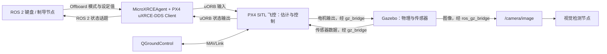

# FPV-Intercept
### 基于视觉伺服的自主拦截无人机系统（PX4 / ROS 2）

<div align="center">


</div>

<div align="center">


</div>

## 项目来源与原作者说明

本项目基于 [Eaglewzw（Verse）](https://github.com/Eaglewzw) 的
[Autonomous-Intercept-Drone](https://github.com/Eaglewzw/Autonomous-Intercept-Drone)
进行本机环境适配与修改，感谢原作者及贡献者的项目实现与资料分享。
以下引用原项目 README 中的说明：

> 本项目是一个面向自主无人机拦截任务的实验验证平台，集成了视觉感知、目标检测、比例导引（PNG）算法及飞行控制方法。该项目旨在为无人机自主拦截、制导算法研究及视觉伺服控制提供一套完整的仿真参考方案，适用于学习与学术研究。
>
> —— [原作者项目说明（中文 README）](https://github.com/Eaglewzw/Autonomous-Intercept-Drone/blob/main/README.zh-CN.md)

本文中的原项目介绍、算法说明及演示资料引用自上游仓库；本机安装配置、
PX4 / ROS 2 接口适配、一键启动与就绪检查等内容为当前版本的补充。

---

## 项目简介

当前工作空间为 `/home/ake/SJTU/适配终端/gazebo_sim`（原项目名 FPV-Intercept），
保留 PX4 / ROS 2 视觉制导与双机仿真代码，并新增 Walls 单机场景和 GanYu 键盘控制入口。
原训练流程还涉及独立的 `End2End-FPVIntercept` 项目；当前同级目录没有附带该项目，
训练及模型部署需另行准备对应代码。

该系统在 ROS 2 环境下开发，结合 PX4 固件与 Gazebo 仿真器，实现了从目标发现到仿真拦截的全链路闭环。主要功能包括：

*   **视觉目标检测**：利用训练的 YOLO 模型和跟踪模型（LightTrack）实时识别并跟踪视场内的无人机目标。
*   **比例导引制导**：基于比例导引律（Proportional Navigation Guidance, PNG）生成拦截轨迹，实现对动态目标的精确前置拦截。
*   **仿真验证体系**：基于 PX4 软件在环（SITL）搭建，支持在 Gazebo 环境中进行算法的离线验证与参数调优。
*   **数据分析工具**：内置运动学与视觉指标记录脚本，用于定量评估制导律精度与视觉追踪稳定性。

---

阅读入口：

- [安装与编译](#快速上手)
- [当前单机入口：Walls 场景 + GanYu 键盘控制](#ganyu-quickstart)
- [GanYu 按键、坐标和参考轨迹](#ganyu-keys)
- [GanYu 输入输出、移植差异和参数](#ganyu-controller)
- [删除自动降落条件后的实际行为](#ganyu-land-policy)
- [GanYu 数据接口、日志与问题排查](#ganyu-topics)
- [Walls 场景的来源与几何布局](assets/gazebo_world/README.md)
- [GanYu 功能包说明](uav_ganyu_control/README.md)
- [原有 uav_keyboard_control 位置控制流程](#keyboard-control)
- [仿真环境组成与 PX4-Autopilot 目录](#simulation-architecture)
- [无人机使用的控制器](#flight-controller)
- [数据话题、订阅示例和 ROS 2 控制接口](#vehicle-data)
- [中文官方文档学习路线](#official-docs)

## 快速上手

### 1. 环境依赖

*   **ROS 2 Version**: Humble
*   **Gazebo**: Gazebo Harmonic（gz-sim 8；本机新场景验证版本为 8.15.0）
*   **PX4 Firmware**: v1.16 (**Micro-XRCE-DDS-Agent**版本推荐v2.4.x)
*   **地面站**: 原双机流程使用 QGroundControl 5.0.8；新 GanYu 客户端也可提供本机仿真地面站心跳
*   **Dependencies**: OpenCV, onnx, colcon

新单机场景和 GanYu 还用到 `ros_gz_bridge`、Eigen3、`rclpy`、`px4_msgs`、
`rosgraph_msgs`、`std_msgs`，以及系统 Python 中的 Pillow、pymavlink。
两个新入口会加载 ROS 2 和本工作空间环境，场景入口还会把 `~/.local/bin` 加入搜索路径。
直接执行 `ros2` 查看数据时，需要在该终端自行加载环境。

### 2. 编译项目

已有本机仿真环境和 `install/setup.bash` 时，仅重编译 GanYu 包：

```bash
cd /home/ake/SJTU/适配终端/gazebo_sim
source /opt/ros/humble/setup.bash
source install/setup.bash
colcon build --symlink-install --packages-select uav_ganyu_control \
  --cmake-args -DCMAKE_BUILD_TYPE=Release
```

尚未构建工作空间时，可先构建 GanYu 及其工作空间依赖：

```bash
cd /home/ake/SJTU/适配终端/gazebo_sim
source /opt/ros/humble/setup.bash
colcon build --symlink-install --packages-up-to uav_ganyu_control \
  --cmake-args -DCMAKE_BUILD_TYPE=Release
source install/setup.bash
```

原视觉/制导功能需要对应的完整依赖；全量构建命令仍为：

```bash
# 在本仓库根目录（即工作空间）编译
source /opt/ros/humble/setup.bash
colcon build --symlink-install
source install/setup.bash
```

修改 C++ 后需要重新编译并重新启动控制器进程；已运行的进程不会自动载入新二进制。
下面先介绍当前单机入口，原有双机和位置键盘流程保留在后面的章节。

<a id="ganyu-quickstart"></a>

### 3. 当前单机入口：Walls 场景 + GanYu 键盘控制

当前实现包含一架 `x500_depth_1`、带碰撞体的四面障碍墙、RGB 相机数据、PX4 状态反馈，
以及从 `sz_indoor_transport` 移植的 `QuadrotorControllerGanYu`。
MID-360、激光点云桥接、地图构建、自动规划绕障和完整任务/地面站协议尚未接入。
启动该入口不会启动目标机、视觉检测或 RL 制导节点。

#### 3.1 终端 1：启动场景

```bash
cd /home/ake/SJTU/适配终端/gazebo_sim
./run_obstacle_scene.sh
```

该脚本直接使用仓库内的 `assets/gazebo_world/walls_demo.sdf`，无需复制新地图到 PX4 目录。
它启动 Gazebo 服务端和 GUI、MicroXRCEAgent、一个 PX4 实例以及相机/时钟桥接，并检查数据。
关键配置如下：

- 世界名称 `walls_demo`；无人机在 Gazebo ENU 原点 `(0, 0, 0)` 生成。
- 机型 `gz_x500_depth`，`PX4_SYS_AUTOSTART=4002`，PX4 实例编号 `1`。
- ROS 命名空间 `/px4_1`，命令目标系统 ID `2`；新场景没有 `/px4_2`。
- 场景沿用已有的 x500 相机模型，本步骤未更换机体或增加雷达。
- 新入口显式使用 `EKF2_HGT_REF=1`，即 GPS 高度参考；旧入口的设置仍保留在原脚本中。
- PX4 工作目录、参数和 ULog 按次保存到 `log/obstacle_scene/<时间>_<后缀>/px4/`。

看到 `READY` 表示四面墙、无人机、有效位置/里程计、图像、相机内参和推进的时钟均已检查。
它不代表 PX4 所有预检已经通过。此时无人机保持未解锁，场景脚本不会自动起飞。
保持该终端运行。

其他启动方式：

```bash
# 不打开 GUI，保持仿真运行，可在另一终端接入键盘控制
./run_obstacle_scene.sh --headless

# 不打开 GUI；只做场景及数据检查，成功后退出本次仿真
./run_obstacle_scene.sh --headless --check

# 将数据就绪等待时间从默认 90 秒延长到 120 秒
./run_obstacle_scene.sh --timeout 120
```

PX4 默认目录为 `~/PX4-Autopilot`，可通过环境变量 `PX4_DIR` 指定已有构建的其他目录。
新入口检测到已有 PX4、Gazebo 世界、重复运行锁或被占用的 Agent UDP 8888 时会拒绝启动。
退出已有场景应在其所属终端操作；新脚本不负责终止其他仿真实例。

#### 3.2 终端 2：启动 GanYu 与键盘

```bash
cd /home/ake/SJTU/适配终端/gazebo_sim
./run_ganyu_keyboard.sh
```

该入口启动 `/ganyu_controller` 和 `/ganyu_keyboard`。启动后不会自行解锁；
终端显示“就绪”后按 `t`，无需回车。状态按以下顺序推进：

```text
IDLE → PRESTREAM → WAIT_OFFBOARD → WAIT_ARM → ACTIVE
```

- `IDLE`：等待起飞操作；`t` 仅在该阶段且未解锁时生效。
- `PRESTREAM`：先持续发送 body-rate 模式心跳和零推力设定值，等待超过 1.5 秒仿真时间。
- `WAIT_OFFBOARD`：请求 PX4 进入 Offboard，并等待状态确认。
- `WAIT_ARM`：等待 `pre_flight_checks_pass=true` 后请求解锁，并等待解锁确认。
- `ACTIVE`：开始由 GanYu 跟踪参考轨迹；默认用 5 秒仿真时间从当前点升至起飞点上方 1.5 m。

界面“就绪”只表示位置、里程计、时钟和状态反馈满足新鲜度检查，不等于飞控预检通过。
若停在 `WAIT_ARM`，应查看 PX4 预检提示。当前已删除阶段超时自动降落，
节点会继续等待；`x` 或 `Ctrl+C` 可以取消等待并退出。

键盘客户端默认尝试占用 UDP 14550 并发送 1 Hz MAVLink 地面站心跳。
若已有 QGroundControl 占用该端口，客户端不启动自己的地面站心跳，保留已有连接。
使用真实地面站时也可以显式关闭内置心跳：

```bash
./run_ganyu_keyboard.sh --external-gcs
```

`--external-gcs` 必须放在 `--ros-args` 前面，只关闭内置 MAVLink 心跳，
不会关闭 `/ganyu/keyboard_alive`。内置心跳只提供连接存活信息，不包含地面站界面或任务功能。

<a id="ganyu-keys"></a>

#### 3.3 按键、坐标与参考轨迹

保持键盘终端获得焦点，使用英文字母。移动方向基于 PX4 本地 NED 世界坐标，
不随机头转动：`x` 向北、`y` 向东、`z` 向下。

- `t`：请求起飞，默认目标相对高度 1.5 m。
- `w / s`：目标分别向北 / 南增加 0.25 m。
- `a / d`：目标分别向西 / 东增加 0.25 m。
- `e / q`：目标分别上升 / 下降 0.25 m。
- `空格`：将当前反馈位置设为目标，再通过参考轨迹平滑过渡；不是瞬间清零速度。
- `l`：主动请求 PX4 LAND，键盘终端继续运行，落地上锁后返回 `IDLE`。
- `x` 或 `Ctrl+C`：先请求降落/取消待起飞流程，等待新状态确认 `IDLE` 且未解锁后退出。
  客户端最多等待 45 秒，超时会报告未确认并退出。

上述数值为默认值。终端帮助文字固定显示默认高度和步长；传入自定义参数后，
以控制节点实际参数和 `Target N/E/up` 日志为准。

每次按键修改的是“最后的目标点”，不是飞机当前位置，也不是速度指令。
例如，默认起飞稳定后按两次 `w`、一次 `d`、一次 `e`，最终相对目标为
北 0.50 m、东 0.25 m、高 1.75 m。长按会产生系统按键重复，连续累加目标；
松开后保持最后目标，切换窗口本身不会触发降落。

目前仍保留这些边界和轨迹设置：

- 水平目标限制为本次 `t` 捕获的起飞点南北、东西各 ±3 m。
- 高度目标限制为该点上方 0.5～3 m；该限制不是地形跟随高度。
- 起飞使用 5 秒参考段；移动和空格使用 2 秒七次多项式参考段。
- 重设目标时保留参考位置、速度、加速度及 jerk 的连续性。
- 没有单独的速度、加速度或 jerk 上限；连续长按、快速反向和边界处重复按键仍会重设轨迹。

目标边界不保证实际位置或中间参考轨迹始终处于范围内。删除自动降落条件没有改变
上述轨迹生成行为，也没有加入碰撞检测或自动绕障。
Gazebo 世界采用 ENU（东、北、上），与 PX4 NED 的轴方向不同，本地原点也可能存在偏移。

#### 3.4 正常结束与重新运行

先在键盘终端按 `l` 或 `x`，或用 `Ctrl+C` 请求降落；观察 `LANDING → IDLE` 和未解锁状态。
`l` 可保留当前键盘会话；`x`、`Ctrl+C` 会结束键盘和本次启动的控制器。
随后在场景终端按 `Ctrl+C`，关闭该入口创建的仿真进程，日志会保留。

键盘客户端收到 `SIGTERM` 时也进入同一退出流程。若客户端无法在 45 秒内确认结束，
入口仍会退出并停止控制节点，此后由 PX4 根据自身状态和配置处理。
只关闭键盘入口不会关闭场景。更新 C++ 后，重新执行 `./run_ganyu_keyboard.sh` 才会使用新版本。

<a id="ganyu-controller"></a>

#### 3.5 GanYu 的输入输出与移植范围

控制核位于 [ganyu.hpp](uav_ganyu_control/include/uav_ganyu_control/ganyu.hpp)，
ROS 接入与状态机位于 [ganyu_controller.cpp](uav_ganyu_control/src/ganyu_controller.cpp)，
键盘客户端位于 [keyboard.py](uav_ganyu_control/scripts/keyboard.py)。
来源是本机 `sz_indoor_transport` 的
`src/sz_indoor_controller/include/sz_indoor_controller/custom/quadrotor_ganyu.h`，
参考提交为 `214d185c2f5658dca4e630ff1fc9027f4daf8c9d`；原 ROS 1 源文件未修改。

每个控制步的输入包括：

- 当前状态：NED 位置 `p`（m）、NED 速度 `v`（m/s）、FRD 机体系到 NED 的旋转矩阵 `R`。
  状态来自 PX4 `VehicleOdometry`；若速度字段为 BODY_FRD，接入层先转换到 NED。
- 参考状态：位置、速度、加速度、jerk，分别为 m、m/s、m/s²、m/s³，由键盘参考生成器提供。
- 仿真时间步长 `dt` 与起飞时捕获的偏航参考。

输出为总推力 `T`（N）和机体系角速度 `omega`（rad/s）。计算先根据位置、速度误差和积分
形成期望力，再根据期望推力方向及其变化率生成角速度。
接入层将结果转换为 `VehicleRatesSetpoint`，`thrust_body=[0,0,-u]`，
其中 `u` 为归一化推力输入；`roll/pitch/yaw` 字段表示三个轴的角速度。
当前链路如下：

```text
键盘目标 → 七次参考轨迹 → GanYu：总推力 + 角速度
  → VehicleRatesSetpoint + OffboardControlMode.body_rate
  → PX4 mc_rate_control → control_allocator → Gazebo 电机/机体
  → 模拟传感器 → PX4 EKF → VehicleOdometry → GanYu
```

GanYu 承担外部位置反馈到推力和角速度的控制计算；此路径使用 PX4 的角速度内环和控制分配。
节点不发布 `TrajectorySetpoint` 或 `VehicleAttitudeSetpoint`。
控制定时器周期为 5 ms（200 Hz），参考推进依赖 `/clock`；实际角速度发布频率还受时钟和计算影响。
消息时间戳沿用节点 ROS 时钟的微秒值，参考轨迹单独使用订阅到的仿真时间。

移植时作出的调整目前仍保留：

- 质量由原 `myparams.json` 的 0.207 kg 改为当前模型各 link 之和约 2.125307692 kg；
  这里只改变控制器参数，没有改写模型质量。
- 推力上限由原配置 20 N 改为 30 N；位置/速度/积分增益分别为三轴 9.75、3.6、0.5，
  `kr=120`、`hr=30`，积分分量限幅 ±5，重力常数 9.81 m/s²。
- 固定偏航目标 1.57 rad 改为起飞时航向，并对偏航误差作角度回绕。
- 时间步长从 ROS 1 内部取时改为显式传入，计算核保留 0.0001～0.05 s 的步长限幅。
- 不沿用原 MAVROS 发送层的 X/Y 交换和原机多项式标定，按当前 NED/FRD 接口直接发送。
- 输出横滚/俯仰角速度限制为 ±1 rad/s，偏航角速度限制为 ±0.5 rad/s。

推力映射使用当前 X500 模型的单电机常数 `k=8.54858e-6`、转速范围 150～1000 rad/s：

```text
speed = sqrt(T / (4 * k))
signal = clamp((speed - 150) / 850, 0, 1)
u = factor * signal² + (1 - factor) * signal
```

`factor` 对应需要匹配的 PX4 `THR_MDL_FAC`，本机验证值为 0；默认质量下悬停输入约 0.742。
该总推力换算基于等转速稳态关系，姿态修正时为近似。节点不会自动读取或写入 PX4 电机参数。

可通过启动参数覆盖的项目为：

- `px4_namespace=/px4_1`、`target_system=2`：PX4 话题前缀和命令目标系统 ID。
- `takeoff_height=1.5`：起飞相对高度，当前接受 0.5～3 m。
- `keyboard_step=0.25`：每次按键增量，当前接受大于 0 且不超过 0.5 m。
- `mass=2.125307692307692`、`max_thrust=30.0`：质量和总推力上限。
- `motor_constant=8.54858e-6`、`motor_speed_min=150.0`、`motor_speed_max=1000.0`。
- `thrust_model_factor=0.0`：上述推力映射中的 factor。

例如，用 2 m 起飞高度和 0.1 m 按键步长启动：

```bash
./run_ganyu_keyboard.sh --ros-args \
  -p takeoff_height:=2.0 -p keyboard_step:=0.1
```

这些参数在构造节点时读取，修改后需重启控制器；不是在线调参接口。
增益、角速度限幅、±3 m / 0.5～3 m 目标边界以及 2 秒/5 秒参考时间当前为代码中的固定值，
未提供对应 ROS 参数。`px4_namespace` 和 `target_system` 应与实际实例同时匹配。

<a id="ganyu-land-policy"></a>

#### 3.6 当前降落行为：附加自动条件已删除

**当前 GanYu 节点不会因为下面这些条件主动发出 LAND：**

- 倾角超过原先设置的 35°。
- 里程计或位置反馈超过原先设置的 0.3 秒未更新。
- 仿真时钟超过 0.5 秒未更新，或飞控状态超过 3 秒未更新。
- 键盘存活心跳超过 2 秒未更新。
- Offboard、解锁等阶段等待超过 15 秒。
- 仿真时间倒退，或一次控制步的仿真时间增量超过 0.5 秒。
- EKF 重置时位置跳变超过 0.25 m 或姿态跳变约 5°。
- 控制计算抛出异常或产生非有限输出。

现在这些情况的具体处理是：

- 反馈变旧或键盘心跳中断不会触发节点降落；有正向仿真时间增量时，继续使用最后接收的有效状态计算。
- 仿真时间未前进或倒退时不执行该步控制计算，但继续发送 Offboard 模式心跳。
- EKF 重置计数变化时清除积分，保留参考目标，不再区分大小跳变来决定降落。
- 控制计算异常时限频记录 `GanYu computation error`，不发布该次无效控制量，继续发送模式心跳。
- 节点自身的降落请求来自 `l`、`x`，以及键盘客户端的 `Ctrl+C` / `SIGTERM` 退出流程。

**起飞前检查仍保留。** 按 `t` 时仍要求位置有效、里程计/位置更新间隔小于 0.3 秒、
时钟更新间隔小于 0.5 秒、状态更新间隔小于 3 秒、键盘心跳间隔小于 1 秒，
并检查其他控制发布者；解锁前仍等待 PX4 预检通过。这里的阈值只用于判断起飞准备状态，
不会在飞行中自动发 LAND。非法坐标系、无效四元数和非有限状态的输入过滤也保留。

**PX4 自身的保护参数没有改动。** 外部节点退出、通信中断或飞控自身检测到故障时，
PX4 仍按自己的配置处理，不能据此认为任何情况下都不会发生降落或模式切换。
人工切换出 Offboard 后，节点进入 `YIELDED` 并停止输出，不会自动抢回控制权。

<a id="ganyu-topics"></a>

#### 3.7 ROS 接口、状态、日志与排查

GanYu 使用的 PX4 输出包括 `/px4_1/fmu/out/` 下的
`vehicle_odometry`、`vehicle_local_position`、`vehicle_status_v1`、
`vehicle_land_detected` 和 `vehicle_command_ack`，订阅采用传感器 QoS。
控制输入为该实例 `/fmu/in/` 下的 `offboard_control_mode`、`vehicle_rates_setpoint`、`vehicle_command`。

上层键盘/状态接口为：

- `/ganyu/keyboard`，`std_msgs/msg/String`：单个按键字符，如 `t`、`w`、`l`。
- `/ganyu/keyboard_alive`，`std_msgs/msg/Empty`：客户端按 10 Hz 发送的存活消息。
- `/ganyu/status`，`std_msgs/msg/String`：约 5 Hz 的 JSON 状态。
- `/ganyu/control_debug`，`std_msgs/msg/Float64MultiArray`：约 20 Hz 的控制与参考调试数组。

`status` 包括 `phase`、`ready`、`preflight`、`armed`、`landed`、`nav_state`、
`position_ned`、`target_ned`、`offset_neu`、`thrust_N` 和 `throttle`。
`offset_neu` 是相对于本次捕获起飞点的北/东/上偏移；`ready` 是反馈准备状态，
`preflight` 才是 PX4 预检标志。`thrust_N` 和 `throttle` 是最后一次计算输出，
进入降落或空闲后可能仍显示旧值，不应解释为当前实际电机输出。

`control_debug` 共 26 项，索引依次为：0 总推力、1 归一化推力、2～4 角速度、
5～7 参考位置、8～10 参考速度、11～13 参考加速度、14～16 参考 jerk、
17～19 积分、20～22 当前位置、23～25 当前速度。
这些接口可供后续上层软件适配；当前未实现 `MissionGoal`、任务上传或独立网络地面站 API。

在另一个终端查看状态和日志：

```bash
cd /home/ake/SJTU/适配终端/gazebo_sim
source /opt/ros/humble/setup.bash
source install/setup.bash
ros2 topic echo /ganyu/status --once
ros2 topic echo /px4_1/fmu/out/vehicle_status_v1 \
  px4_msgs/msg/VehicleStatus --qos-reliability best_effort --once
ros2 topic echo /px4_1/fmu/out/vehicle_local_position \
  px4_msgs/msg/VehicleLocalPosition --qos-reliability best_effort --once
tail -n 80 log/ganyu_control/latest/controller.log
tail -n 80 log/obstacle_scene/latest/px4.log
```

新场景还桥接 `/clock`、`/camera/image`、`/camera/camera_info`，本机验证 RGB 为 1920×1080。
没有桥接激光点云或深度图。重新检查场景时，可在上述已加载环境的终端执行：

```bash
/usr/bin/python3 scripts/check_obstacle_scene.py --output log/obstacle_scene/latest
```

运行日志按次保存，`latest` 为最近一次运行的符号链接：

- `log/obstacle_scene/<时间>_<后缀>/`：Gazebo、GUI、Agent、PX4、桥接日志、
  `verification.json`、相机快照和独立的 `px4/` 目录。
- `log/ganyu_control/<时间>_<后缀>/`：控制器日志和进程编号。
- `log/ganyu_control/keyboard_validation_final/`：原小步键盘试飞的记录。

常见现象的含义：

- **启动后不飞**：新入口默认未解锁，需要按 `t`；这与原位置键盘节点启动即请求解锁的行为不同。
- **`Takeoff rejected`**：按 `t` 时数据/心跳未就绪，或有其他设定值发布者；恢复条件后重新按 `t`。
- **停在 `WAIT_OFFBOARD` / `WAIT_ARM`**：查看 ACK 和 PX4 预检日志；当前不会因等待 15 秒而自动降落。
- **删除条件后仍看到 `Excessive tilt`**：检查日志时间及是否仍运行旧进程；历史日志不会被自动删除，
  旧二进制需要退出后重新编译、启动。
- **长按后速度或倾角较大**：当前参考生成仍没有独立的速度/加速度上限，删除降落分支没有修正这一行为。
- **`Another ... session is running` 或端口占用**：在原会话所属终端结束对应进程，再启动新会话。
  新场景入口会自行启动 MicroXRCEAgent，无需另开终端再次运行 Agent。
  如果提示 `UDP 8888 is in use`，可用 `ss -lunp 'sport = :8888'` 查看占用者；
  确认所属仿真已结束后，只停止对应的残留 Agent，再重启场景。
- **人工切换模式后键盘不再驱动飞机**：检查是否处于 `YIELDED`；该阶段不会自动重新进入 Offboard。

本机验证记录（2026-10-25）：GanYu 的 500 组源码公式对照在匹配参数和偏航条件下通过；
原小步键盘试飞完成起飞、移动、悬停、降落，全程参考跟踪 RMSE 约 0.018 m。
该试飞发生在删除附加降落条件之前，未覆盖持续长按和连续快速反向，不能代表这些操作已经验证稳定。
删除条件后，重新编译及 14 项隔离 ROS 回归检查通过，覆盖超时、大倾角、EKF 跳变、
时钟跳变、数值异常不发 LAND，以及主动降落仍有效；该回归使用模拟 PX4 消息，
不等同于新一轮 Gazebo 动力学试飞。

<a id="keyboard-control"></a>

### 4. 原有 uav_keyboard_control 位置键盘流程

本节是保留的旧节点，其按键方向、默认高度和退出行为与 GanYu 不同。
使用上一节 GanYu 时，不要同时启动本节的控制节点。

该包的可执行文件是 `uav_keyboard_control`，ROS 节点名是
`/drone_keyboard_control`，实现见 [uav_keyboard_control/src/main.cpp](uav_keyboard_control/src/main.cpp)。
它通过 PX4 **Offboard 位置控制**操作第一架飞机 `/px4_1`，默认不控制 `/px4_2`。

#### 启动顺序

1. **终端 1：只启动仿真底座。** `setup_workspace.sh` 已复制资源；若尚未复制，先执行
   下列两个 `cp`。修改本仓库的脚本或世界文件后，也要重新复制。

   ```bash
   cd /home/ake/SJTU/适配终端/gazebo_sim
   cp ./run_swarm.sh ~/PX4-Autopilot/run_swarm.sh
   cp ./assets/gazebo_world/grass_world.sdf ~/PX4-Autopilot/Tools/simulation/gz/worlds/
   cd ~/PX4-Autopilot
   bash ./run_swarm.sh
   ```

   等待脚本提示全部就绪，保持这个终端运行。脚本会生成两架飞机，第二架可以留在地面。
   只启动仿真底座，不同时启动目标运动、视觉或 RL 控制节点。
   当前工作空间没有提供原项目的 `start.sh` 一键拦截入口。

2. **终端 2：启动 QGroundControl。** 等待地面站显示两架飞机连接，并检查预飞提示。

   ```bash
   ~/Applications/QGroundControl-v5.0.8-x86_64.AppImage
   ```

3. **终端 3：启动键盘节点。** 保持该终端获得键盘焦点，使用小写字母，无需按回车。
   应在真实交互终端运行，不要把标准输入重定向到文件或后台运行。

   ```bash
   cd /home/ake/SJTU/适配终端/gazebo_sim
   source /opt/ros/humble/setup.bash
   source install/setup.bash
   ros2 run uav_keyboard_control uav_keyboard_control
   ```

   节点启动后立即持续请求 **进入 Offboard 和解锁**，同时发送位置目标
   `(x, y, z) = (0, 0, -5)`、偏航角 `yaw = -3.14 rad`。
   请求被 PX4 接受后，飞机会自动飞向本地原点上方约 5 m 的位置，无需另按起飞键。
   日志 `Arm command send` 只表示发送了请求，是否成功需查看地面站或状态话题。

#### 按键含义：以当前源码和 NED 坐标为准

位置指令采用 PX4 本地 **NED** 坐标：`x` 向北、`y` 向东、`z` 向下，单位为米。
这些方向相对于本地世界坐标，而不是机头或 Gazebo 观察相机的方向。
每读取一次按键，目标位置对应分量变化 **0.1 m**：

- `w`：`x += 0.1`，向北移动目标点；同时将目标偏航设为 `-3.14 rad`。
- `s`：`x -= 0.1`，向南移动目标点；同时将目标偏航设为 `-3.14 rad`。
- `a`：`y += 0.1`，向东移动目标点。
- `d`：`y -= 0.1`，向西移动目标点。
- `q`：`z += 0.1`，目标点**下降** 0.1 m。
- `e`：`z -= 0.1`，目标点**上升** 0.1 m。

**源码中 `q/e` 的 `Moving Up/Down` 日志与实际升降相反，以上按坐标值解释。**
默认 `yaw ≈ -π` 时机头朝南，因此日志中的 Forward/Left 也不能作为机体方向解释。
例如，从初始设定值连续按 10 次 `w`，目标变为 `(1, 0, -5)`；再按 5 次 `e`，
目标变为 `(1, 0, -5.5)`。长按依赖操作系统的按键重复；松开后继续保持最后目标点。
当前节点没有独立的偏航调节键、暂停键或自动降落键。

#### 退出与当前实现限制

- `x` 只退出键盘读取循环，**后台线程仍会发送 Offboard、解锁和位置指令**，不能用它结束控制。
  结束试验使用键盘终端的 `Ctrl+C`，确认进程退出；若终端回显异常，可执行 `stty sane`。
  节点没有完善的线程退出清理，退出时可能出现 `terminate` 报错。
- 停止节点不会发送降落指令。停止后 PX4 会按 Offboard 丢失保护参数处理；需要降落时，
  停止键盘节点后通过 QGroundControl 对应飞机选择降落。也可以在仿真终端按 `Ctrl+C`
  结束整个场景，下一次启动重新试验。持续运行键盘节点时，它会反复请求 Offboard 和解锁。
- 当前控制循环实际写的是 `sleep_for(microseconds(10))`，不是注释中的 100 ms，
  会高频发送控制和解锁请求；它是一个基础示例，尚未实现按状态确认后停止重发的状态机。
- 当前状态订阅仍使用旧话题 `/px4_1/fmu/out/vehicle_status` 和默认可靠 QoS，
  且构造函数被键盘循环阻塞，正常键盘操作期间尚未进入 `rclcpp::spin()`。
  因此不要依赖它的状态回调判断是否解锁；本机 PX4 v1.16 的实际状态话题是
  `/px4_1/fmu/out/vehicle_status_v1`，可用下面的命令独立确认。
- 同一架飞机一次只运行一个控制节点。不要与 `uav_vehicle_controller`、
  `uav_png_intercept`、`uav_vision_png`、`uav_rl_guidance` 或 `uav_ibvs_control` 同时控制 `/px4_1`。
  其中 `uav_vehicle_controller` 是另一个速度控制示例，与此包的位置控制按键含义不同。

```bash
# 另开终端，在本仓库根目录加载 ROS 2 和工作空间。
source /opt/ros/humble/setup.bash
source install/setup.bash
ros2 topic echo /px4_1/fmu/out/vehicle_status_v1 \
  px4_msgs/msg/VehicleStatus --qos-reliability best_effort --once
ros2 topic echo /px4_1/fmu/out/vehicle_local_position \
  px4_msgs/msg/VehicleLocalPosition --qos-reliability best_effort --once
```

解锁状态应为 `arming_state: 2`（`ARMING_STATE_ARMED`），Offboard 应为
`nav_state: 14`（`NAVIGATION_STATE_OFFBOARD`）。若未起飞，先检查 QGC 连接、预飞错误、
本地位置/速度的有效标志，以及 `~/PX4-Autopilot/drone1.log`，不要只看节点的发送日志。

### 5. 原有双机自动拦截流程

以下流程依赖完整视觉/推理环境，独立于前面的 Walls + GanYu 单机入口。
每个直接执行 `ros2 run` 的终端都应先加载 `/opt/ros/humble/setup.bash` 和本仓库 `install/setup.bash`。

0. **启动仿真环境**:
   在本仓库根目录执行，启动前将原有双机仿真资源复制到 PX4-Autopilot 目录下：

   ```bash
   # 步骤1: 将本仓库的 run_swarm.sh 复制到 PX4-Autopilot 根目录（若尚未复制）
   cp ./run_swarm.sh ~/PX4-Autopilot/

   # 步骤2: 将自定义世界文件复制到 PX4 Gazebo 世界目录
   cp ./assets/gazebo_world/grass_world.sdf ~/PX4-Autopilot/Tools/simulation/gz/worlds/
   ```

   > 首次使用或修改脚本/地图后复制；资源未变化时，之后直接在 PX4-Autopilot 目录启动：
   ```bash
   cd ~/PX4-Autopilot
   ./run_swarm.sh
   ```

   该脚本会自动启动 Gazebo 仿真服务器、两架无人机（px4_1 拦截机 + px4_2 目标机）、MicroXRCEAgent 以及相机话题桥接。
   启动和退出时，会额外按完整命令行清理当前用户的 `gz sim` 服务端和图形界面，
   避免系统进程名为 `ruby` 而被原来的 `killall` 漏掉。启动流程保持原样，
   不检查 `px4_msgs`，无需为启动此脚本额外加载本工作空间。

   **启动目标节点前，打开 QGroundControl 并等待两架飞机通过 UDP 14550 自动连接。**
   本机安装位置为：

   ```bash
   ~/Applications/QGroundControl-v5.0.8-x86_64.AppImage
   ```

   Ubuntu 22.04 使用 [QGroundControl 5.0 系列](https://docs.qgroundcontrol.com/Stable_V5.0/en/qgc-user-guide/getting_started/download_and_install.html)。
   当前 PX4 配置要求地面站连接；否则 `drone2.log` 会报告
   `Preflight Fail: No connection to the ground control station` 并拒绝解锁。
   `Arm command sent` 仅表示目标节点发送了请求。目标节点仅请求一次解锁，
   若连接地面站前已经启动过该节点，连接成功后应在该节点终端按 Ctrl+C 并重新运行。


1. **启动目标机仿真**:
   ```bash
   # 默认圆周运动
   ros2 run uav_target_sim uav_target_sim

   # 或通过参数选择运动模式和活动范围
   ros2 run uav_target_sim uav_target_sim --ros-args -p motion_mode:=sinusoidal -p max_range:=10.0

   # 也可使用 launch 文件
   ros2 launch uav_target_sim target_sim.launch.py motion_mode:=random_walk
   ```

   **支持的目标运动模式**：

   | 参数值 | 运动模式 | 运动学公式 | 特点 |
   | :--- | :--- | :--- | :--- |
   | `circle` | 匀速圆周 | R=5m, w=0.5rad/s | 默认模式，半径5m匀速圆周运动 |
   | `sinusoidal` | 正弦机动 | a=0.5*sin(0.5t) m/s<sup>2</sup> | 前向匀速1m/s + 侧向正弦加速度，周期性规避 |
   | `random_walk` | 随机游走 | v(t+dt) = v(t) + N(0, 0.2) | 速度随机扰动，限速3m/s，无规律逃逸 |

   > `max_range` 参数（默认10m）控制目标活动范围，防止目标飞出拦截机视野。

2. **启动视觉制导拦截**:
   ```bash
   # 推荐直接运行（使用 .hpp 中的默认参数）
   ros2 run uav_vision_png uav_vision_png

   # 或通过 launch 文件加载 config/params.yaml 中的参数
   ros2 launch uav_vision_png vision_png.launch.py
   ```

   > **参数配置说明**：`uav_vision_png` 节点的参数优先级为：
   >   **launch 命令行 > params.yaml > .hpp 成员初始值**
   >
   > - 使用 `ros2 run` 直接启动：参数取 `.hpp` 中的默认值，**`params.yaml` 不会自动加载**，需手动传参 `--ros-args -p 参数名:=值`
   > - 使用 `ros2 launch` 启动：launch 文件自动加载 `config/params.yaml`，YAML 中的值会覆盖 `.hpp` 默认值
   > - 调试时可用 `ros2 param get /uav_vision_png <参数名>` 查看当前实际生效的值
   > - 可调参数详见 `uav_vision_png/config/params.yaml`，含 PNG 增益、视场补偿、起飞高度等

2-备. **启动 RL 学习制导拦截 (替代方案)** 🆕:
   `uav_rl_guidance` 是基于强化学习（BC + PPO）训练的 GRU 策略制导节点，用于取代传统 PNG 算法。
   它与 `uav_vision_png` 保持相同的话题接口、状态机和 CSV 统计格式，可无缝替换。
   使用 ONNX Runtime 推理，零 PyTorch 依赖，纯 C++ 实现。

   ```bash
   # 方式1：launch 启动（自动加载 config/params.yaml）
   ros2 launch uav_rl_guidance rl_guidance.launch.py

   # 方式2：直接运行（使用代码默认参数）
   ros2 run uav_rl_guidance uav_rl_guidance

   # A/B 基线模式：全程使用内置 PNG，不加载策略模型（与 uav_vision_png 等价）
   ros2 launch uav_rl_guidance rl_guidance.launch.py fallback_png:=true

   # 台架调试：跳过起飞，直接进入 SEARCHING
   ros2 launch uav_rl_guidance rl_guidance.launch.py bench_test:=true
   ```

   > **架构说明**：RL 策略在 INTERCEPT 阶段输出速度指令；若策略出现异常（watchdog），自动回退到内置 PNG 控制器。
   > 策略模型（ONNX `.onnx`）存放在 `uav_rl_guidance/models/` 下，
   > 配套训练项目 `End2End-FPVIntercept` 需要单独准备，当前目录未附带；
   > 其上游项目为 [AeroIntercept](https://github.com/Eaglewzw/AeroIntercept)。
   > 当前节点使用 15 维观测的 GRU 策略，更新兼容的 `uav_rl_guidance/models/policy.pt` 后，
   > 在本仓库根目录执行 `python3 uav_rl_guidance/src/export_onnx.py`；端到端图像策略需使用其对应的部署接口。

3. **启动视觉检测**:
   ```bash
   ros2 run uav_vision_dectect uav_vision_dectect
   ```

<a id="simulation-architecture"></a>

## 仿真环境是如何搭建起来的

本项目采用 **SITL（Software In The Loop，软件在环）**：在电脑上运行 PX4 飞控程序，
由 Gazebo 提供虚拟飞机、物理运动和传感器。本仓库提供外部 ROS 2 算法节点与启动脚本。
环境中的各部分分工如下：

- **Gazebo Harmonic**：按入口加载 [grass_world.sdf](assets/gazebo_world/grass_world.sdf)
  或 [walls_demo.sdf](assets/gazebo_world/walls_demo.sdf)，
  模拟重力、碰撞、电机及 IMU、气压计、磁力计、GPS、相机等传感器。
- **PX4-Autopilot v1.16.0**：每架飞机对应一个 PX4 SITL 进程，负责状态估计、
  解锁/模式管理、飞行控制和失联保护，通过 PX4 自带的 `gz_bridge` 与 Gazebo 交互。
- **MicroXRCEAgent v2.4.3**：本机监听 UDP 8888，与 PX4 内的 `uxrce_dds_client`
  通信，将选定的 PX4 uORB 消息接入 ROS 2 DDS，供节点订阅或发布。
- **ros_gz_bridge**：原双机入口桥接 `/camera/image`；新单机入口还桥接
  `/camera/camera_info` 和 `/clock`。飞机状态和控制指令走上面的 DDS 链路。
- **本仓库 ROS 2 节点**：原键盘节点发送位置目标，GanYu 节点计算总推力和角速度；
  目标机节点生成运动轨迹，PNG、视觉制导或 RL 节点生成外部制导指令。
- **QGroundControl / 本机 GCS 心跳**：经 MAVLink/UDP 14550 与 PX4 通信，
  与 ROS 2 DDS 是两条链路。原双机流程连接 QGC；新 GanYu 流程可使用客户端内置心跳，
  QGC 另提供状态、参数和地面站命令界面。



原双机流程的安装与启动分为三个阶段：

1. [install_system_dependencies.sh](scripts/install_system_dependencies.sh) 安装系统编译依赖、
   Gazebo Harmonic、适配 Humble 的 `ros_gzharmonic` 和视觉推理库。
   脚本假定已有 `/opt/ros/humble`；它会替换旧 Gazebo/ros_gz 包，全量视觉环境还需满足
   ONNX Runtime 的 CUDA 运行库依赖。
2. [setup_workspace.sh](scripts/setup_workspace.sh) 下载固定版本的 PX4 及子模块、
   编译安装 Agent、编译本工作空间的消息和算法节点、复制世界/启动脚本，
   为 DDS 增加 `hover_thrust_estimate` 导出，最后构建 `px4_sitl_default`。
3. [run_swarm.sh](run_swarm.sh) 启动 Agent，再启动带相机的 PX4 实例 1：
   `PX4_SYS_AUTOSTART=4002`、`PX4_SIM_MODEL=gz_x500_depth`、`px4 -i 1`，
   由它启动 `grass_world`；等待 15 秒并启动相机桥接后，再启动普通 x500 的实例 2：
   `PX4_SYS_AUTOSTART=4001`、`PX4_SIM_MODEL=gz_x500`、`px4 -i 2`。
   第二个实例设置 `PX4_GZ_STANDALONE=1`，连接同一个 Gazebo 世界。

当前单机入口 [run_obstacle_scene.sh](run_obstacle_scene.sh) 则先用本仓库 SDF 启动 Gazebo，
再以 `PX4_GZ_STANDALONE=1` 启动一个 4002 实例连接 `walls_demo`。
它使用独立 PX4 工作目录和绝对资源路径，从工作空间直接启动即可；GanYu 由另一个入口单独启动。

脚本实际设置的 Gazebo 初始位置是第一架 `PX4_GZ_MODEL_POSE="0,0"`，
第二架 `"20,0"`（Gazebo 世界的 x、y，单位 m）；脚本末尾摘要中的第二架 `(0,20)`
与设置不一致，应以启动命令为准。这些生成位置不能直接当作各自 PX4 本地 NED 位置。
新 Gazebo 的启动参数及多机方式可对照官方
[Gazebo 仿真](https://docs.px4.io/v1.16/zh/sim_gazebo_gz/)和
[多机仿真](https://docs.px4.io/v1.16/zh/sim_gazebo_gz/multi_vehicle_simulation)。

### PX4-Autopilot 文件夹是什么，为什么要在里面启动

`~/PX4-Autopilot` 是官方 [PX4/PX4-Autopilot](https://github.com/PX4/PX4-Autopilot/tree/v1.16.0)
飞控源码仓库。本项目使用其中的 Linux SITL 构建；同一源码体系也能为真实飞控板编译固件。
它与当前 ROS 2 工作空间是两个独立目录：

- 本仓库：`uav_*` 为外部节点，`px4_msgs/msg/` 为 ROS 2 消息定义；
  `build/`、`install/`、`log/` 是 colcon 产物。`px4_msgs` 本身不运行飞控。
- `~/PX4-Autopilot/build/px4_sitl_default/bin/px4`：编译得到的飞控可执行程序。
- `~/PX4-Autopilot/ROMFS/px4fmu_common/`：启动脚本和机型配置，包含 4001/4002 对应的 x500 配置。
- `~/PX4-Autopilot/Tools/simulation/gz/`：Gazebo 模型、世界与配套资源。
- `~/PX4-Autopilot/src/modules/`：状态估计器、控制器、DDS 客户端等飞控模块源码。

**必须切换目录是当前 `run_swarm.sh` 的相对路径要求。** 它检查并执行
`./build/px4_sitl_default/bin/px4`，日志也写在当前目录，所以只写
`bash ~/PX4-Autopilot/run_swarm.sh` 并不会自动改变工作目录。
在已加载 ROS 2 的终端，可以从任意目录这样启动原双机场景：

```bash
(cd ~/PX4-Autopilot && bash ./run_swarm.sh)
```

ROS 2 节点可在任意已加载工作空间环境的终端运行，无需放进 PX4 目录。
当前工作空间没有 `env.sh` 或 `start.sh`；直接运行 ROS 命令时使用
`source /opt/ros/humble/setup.bash` 和 `source install/setup.bash` 加载环境。
新单机场景从工作空间运行 `./run_obstacle_scene.sh`，无需切换到 PX4 目录。
官方常见命令 `make px4_sitl gz_x500` 是另一种单机入口，本项目脚本直接使用已有构建。

<a id="flight-controller"></a>

## 仿真器中无人机的控制器是什么

当前存在两条控制路径：原位置键盘/PNG/RL 使用 PX4 内部的相关位置、速度、姿态控制环；
新增 GanYu 在 ROS 2 进程中根据位置反馈计算总推力和角速度，再使用 PX4 的角速度内环。
Gazebo 在两种路径下都负责电机和机体的物理运动。

原 `uav_keyboard_control` 位置控制对应的主链路是：

```text
键盘位置目标 TrajectorySetpoint
  → mc_pos_control：位置 P 控制 → 速度 PID 控制 → 推力与姿态目标
  → mc_att_control：基于四元数的姿态比例控制 → 角速度目标
  → mc_rate_control：角速度 PID 控制 → 力矩目标
  → control_allocator：把推力/力矩分配给各电机
  → Gazebo 电机与机体物理模型
```

反馈由 PX4 的 `ekf2` 等模块根据模拟传感器估计。发送速度设定值时可跳过位置环；
发送角速度/推力等更底层设定值时，所使用的控制环也会变化，取决于 `OffboardControlMode`
和消息内容。本仓库的 `uav_ganyu_control` 和 `uav_ibvs_control` 发布 `VehicleRatesSetpoint`，
不能把所有节点都理解成同一种位置控制。GanYu 的完整链路和参数见
[输入输出与移植范围](#ganyu-controller)；调节 PX4 的 `MPC_*` 不等于调节 GanYu 的位置反馈增益。

可从 `~/PX4-Autopilot/ROMFS/px4fmu_common/init.d/rc.mc_apps` 查看控制模块启动，
从 `src/modules/mc_pos_control/`、`mc_att_control/`、`mc_rate_control/`、
`control_allocator/`、`ekf2/` 阅读实现。控制参数可在 QGC 中查询，常见前缀包括
`MPC_*`、`MC_ROLL*`、`MC_PITCH*`、`MC_YAW*`、`CA_*`。
环路结构和参数作用见官方[控制器图解](https://docs.px4.io/v1.16/zh/flight_stack/controller_diagrams)。

<a id="vehicle-data"></a>

## 无人机数据在哪里发布，在哪里调用

### 数据从哪里来，哪些话题能读

PX4 的传感器/估计/状态模块先发布内部 **uORB** 消息，再由
`uxrce_dds_client → MicroXRCEAgent → ROS 2` 导出。`/fmu/out/` 表示从飞控输出，
`/fmu/in/` 表示送入飞控，方向以 PX4 为参照。导出清单位于：

```text
~/PX4-Autopilot/src/modules/uxrce_dds_client/dds_topics.yaml
```

其中 `publications` 是 PX4 向外发布，`subscriptions` 是 PX4 接收外部输入。
**`px4_msgs/msg/` 中有某个消息定义，不代表运行时一定发布该话题。**
新增 DDS 导出通常要修改该 YAML 并重新编译 PX4；已有消息还需确认实际产生了数据。
详细规则见官方 [uXRCE-DDS 桥接](https://docs.px4.io/v1.16/zh/middleware/uxrce_dds)。

原双机入口的实例 1/2 使用 `/px4_1`、`/px4_2` 命名空间；新单机入口只有实例 1。
默认 `MAV_SYS_ID` 分别为 **2/3**，`UXRCE_DDS_KEY` 也分别为 **2/3**；
系统 ID 用于命令目标，DDS key 用于区分客户端，它们用途不同。
PX4 v1.16 对非零消息版本添加话题后缀，本仓库 `VehicleStatus.MESSAGE_VERSION = 1`，
因此状态话题实际为 `vehicle_status_v1`，即使 YAML 条目仍写 `vehicle_status`。

常用输出如下；在原双机场景中，将 `/px4_1` 换成 `/px4_2` 可查看第二架飞机：

- `/px4_1/fmu/out/vehicle_local_position` → `px4_msgs/msg/VehicleLocalPosition`：
  本地 NED 位置 `x/y/z`、速度 `vx/vy/vz`、加速度、航向及位置/速度有效标志。
- `/px4_1/fmu/out/vehicle_odometry` → `px4_msgs/msg/VehicleOdometry`：
  `position`、姿态四元数 `q`（`w,x,y,z`）、`velocity`、机体角速度；
  读取时同时检查 `pose_frame`、`velocity_frame`，不要默认所有字段都在同一坐标系。
- `/px4_1/fmu/out/vehicle_attitude` → `px4_msgs/msg/VehicleAttitude`：姿态四元数。
- `/px4_1/fmu/out/vehicle_gps_position` → `px4_msgs/msg/SensorGps`：模拟 GPS 输出；
  `/px4_1/fmu/out/vehicle_global_position` → `px4_msgs/msg/VehicleGlobalPosition`：融合后的全局位置。
- `/px4_1/fmu/out/sensor_combined` → `px4_msgs/msg/SensorCombined`：组合后的陀螺仪/加速度计数据。
- `/px4_1/fmu/out/vehicle_status_v1` → `px4_msgs/msg/VehicleStatus`：解锁、导航模式、地面站连接等状态。
- `/px4_1/fmu/out/vehicle_command_ack` → `px4_msgs/msg/VehicleCommandAck`：命令是否接受及拒绝原因。
- `/px4_1/fmu/out/vehicle_land_detected` → `px4_msgs/msg/VehicleLandDetected`：落地判定，GanYu 用于结束降落阶段。
- `/px4_1/fmu/out/hover_thrust_estimate` → `px4_msgs/msg/HoverThrustEstimate`：悬停推力估计，
  本项目安装脚本额外启用，估计器运行后才有有效结果。
- `/camera/image` → `sensor_msgs/msg/Image`：第一架机的相机图像，由 `run_swarm.sh`
  将 Gazebo 的 `/world/grass_world/model/x500_depth_1/link/camera_link/sensor/IMX214/image`
  单向桥接出来。新 `run_obstacle_scene.sh` 从 `walls_demo` 的对应相机路径桥接相同 ROS 话题。
- `/camera/camera_info` → `sensor_msgs/msg/CameraInfo`：新单机入口桥接的相机内参。
- `/clock` → `rosgraph_msgs/msg/Clock`：新单机入口桥接的仿真时间，供 GanYu 推进参考轨迹。
  两个入口目前都没有额外桥接深度图，当前也没有 MID-360 点云话题。
- `/camera_detect_result` → `uav_common_msg/msg/RectMsg`：视觉节点运行后发布的检测框。
  它是算法输出；当前检测发布代码将 `depth` 固定为 0，不能把它当作测距数据。

PX4 本地位置是估计值，不是直接读取 Gazebo 真值。各机的本地原点可能不同，
双机位置比较应先统一参考系。使用 ROS 常见 ENU/FLU 数据时也要显式转换到 PX4 的 NED/FRD，
DDS 不会自动转换坐标。字段和单位以本仓库 `.msg` 及官方
[uORB 消息参考](https://docs.px4.io/v1.16/zh/msg_docs/)为准。

### 在终端查看和记录数据

在本仓库根目录加载环境，保持仿真运行：

```bash
source /opt/ros/humble/setup.bash
source install/setup.bash
ros2 topic list
ros2 topic info /px4_1/fmu/out/vehicle_odometry --verbose
ros2 interface show px4_msgs/msg/VehicleOdometry
ros2 topic echo /px4_1/fmu/out/vehicle_odometry \
  px4_msgs/msg/VehicleOdometry --qos-reliability best_effort --once
ros2 topic echo /px4_1/fmu/out/vehicle_local_position \
  px4_msgs/msg/VehicleLocalPosition --qos-reliability best_effort --once
ros2 topic hz /camera/image
```

订阅 PX4 输出使用 `best_effort`/传感器 QoS，避免出现“能看到话题却收不到消息”。
录制飞控状态可执行下列命令，按 `Ctrl+C` 结束；回放时也需加载同一工作空间的消息定义。

```bash
ros2 bag record /px4_1/fmu/out/vehicle_odometry \
  /px4_1/fmu/out/vehicle_local_position /px4_1/fmu/out/vehicle_status_v1
```

### 仓库代码在哪里调用这些数据

- [ganyu_controller.cpp](uav_ganyu_control/src/ganyu_controller.cpp)：
  接收里程计、位置有效标志、飞控状态、落地判定及命令 ACK，运行 GanYu 控制并发布状态/调试数据。
- [uav_vision_png/src/vision_png_control.cpp](uav_vision_png/src/vision_png_control.cpp)：
  构造函数订阅里程计、位置、状态、GPS、悬停推力和检测结果，在回调中更新内部状态。
- [uav_rl_guidance/src/rl_guidance_node.cpp](uav_rl_guidance/src/rl_guidance_node.cpp)：
  订阅同类飞行/视觉数据，构建策略观测并发布制导设定值。
- [uav_target_sim/src/uav_target_sim.cpp](uav_target_sim/src/uav_target_sim.cpp)：
  订阅目标机 GPS，并向 `/px4_2/fmu/in/*` 发送轨迹和命令。
- [uav_vehicle_controller.cpp](uav_vehicle_controller/include/uav_vehicle_controller/uav_vehicle_controller.cpp)：
  `vehicle_odometry_callback()` 将里程计四元数转为欧拉角。
- [uav_topic_subscrib.cpp](uav_vision_dectect/src/uav_topic_subscrib.cpp)：
  订阅 `/camera/image`，发布 `/camera_detect_result`；当前 `main.cpp` 中飞行控制类的实例化已注释。
- [recorder_node.py](uav_bc_recorder/uav_bc_recorder/recorder_node.py)：
  订阅图像、里程计、位置、GPS 和设定值，作为 Python 数据采集参考。

例如，在已加载环境的终端直接运行下面的 Python ROS 2 节点，即可每秒打印一次有效的本地位置。
它只订阅数据，按 `Ctrl+C` 退出：

```bash
python3 - <<'PY'
import rclpy
from rclpy.node import Node
from rclpy.qos import qos_profile_sensor_data
from px4_msgs.msg import VehicleLocalPosition

class PositionReader(Node):
    def __init__(self):
        super().__init__('position_reader')
        self.latest = None
        self.sub = self.create_subscription(
            VehicleLocalPosition, '/px4_1/fmu/out/vehicle_local_position',
            self.on_position, qos_profile_sensor_data)
        self.timer = self.create_timer(1.0, self.report)

    def on_position(self, msg):
        self.latest = msg

    def report(self):
        msg = self.latest
        if msg is not None and msg.xy_valid and msg.z_valid:
            self.get_logger().info(
                f'NED: x={msg.x:.2f}, y={msg.y:.2f}, z={msg.z:.2f} m')

rclpy.init()
node = PositionReader()
try:
    rclpy.spin(node)
except KeyboardInterrupt:
    pass
finally:
    node.destroy_node()
    if rclpy.ok():
        rclpy.shutdown()
PY
```

### 能否用自己写的 ROS 节点控制

**可以，仓库里的键盘、目标机和制导程序本身就是 ROS 2 控制节点。**
当前使用 `px4_msgs + uXRCE-DDS`，无需再启动 MAVROS；也没有默认接收 `/cmd_vel` 的转换节点。
自己的 C++/Python 节点可订阅上述状态，再发布以下输入：

- `/px4_1/fmu/in/offboard_control_mode`（`OffboardControlMode`）：选择位置、速度、姿态等控制层级，
  持续提供外部控制心跳。
- `/px4_1/fmu/in/trajectory_setpoint`（`TrajectorySetpoint`）：发送本地 NED 位置/速度/加速度与偏航目标。
  例如位置模式使用 `position=true`；纯速度模式使用 `position=false, velocity=true`，
  并将 `TrajectorySetpoint.position` 的三个分量设为 `NaN`，避免仍被位置目标接管。
  其他不使用的设定值也按接口语义设为 `NaN`，不能把全零初始化理解为“忽略该字段”。
- `/px4_1/fmu/in/vehicle_command`（`VehicleCommand`）：请求切换 Offboard、解锁、降落等动作，
  并订阅 `vehicle_command_ack` 和状态消息确认结果。
- `/px4_1/fmu/in/vehicle_rates_setpoint`（`VehicleRatesSetpoint`）：角速度和机体系推力输入，
  与 `OffboardControlMode.body_rate=true` 配合；GanYu 当前使用这条控制路径。

节点应使用定时器持续发送心跳和设定值（例如 10–50 Hz），在请求 Offboard/解锁前先提供
超过 1 秒的心跳；PX4 要求心跳频率高于 2 Hz，并要求对应层级的状态估计有效。
心跳停止后会触发 `COM_OF_LOSS_T` 等参数规定的保护行为。消息 `timestamp` 使用微秒，
本仓库 C++ 发布代码采用 `now().nanoseconds() / 1000`。模式和坐标要求见官方
[Offboard 模式](https://docs.px4.io/v1.16/zh/flight_modes/offboard)及
[ROS 2 Offboard 示例](https://docs.px4.io/v1.16/zh/ros2/offboard_control)。

本配置下第一架 `VehicleCommand.target_system=2`，第二架为 `3`，
`target_component=1`、`from_external=true`。想控制第二架时，需同时修改/重映射输入话题和
命令目标 ID；仅把 `/px4_1` 改为 `/px4_2` 不足以改变代码中写死的 `target_system`。
多个控制节点不要同时发布同一架飞机的设定值。

<a id="official-docs"></a>

## 中文官方文档学习路线

本环境固定使用 PX4 v1.16.0，建议先读 **v1.16 中文站**，避免照搬 `main` 或其他版本的
话题名、Gazebo Classic/MAVROS 教程。下列均为 PX4 官方文档的中文入口；部分章节翻译尚不完整，
页面可能包含英文，遇到差异时结合本地 v1.16 源码核对。

1. [PX4 v1.16 中文用户指南](https://docs.px4.io/v1.16/zh/)：先了解飞控、地面站、解锁和飞行模式。
2. [Ubuntu 开发环境](https://docs.px4.io/v1.16/zh/dev_setup/dev_env_linux_ubuntu)：理解下载源码、
   安装工具链和构建 PX4 的过程；本仓库依赖组合以自己的安装脚本为准。
3. [Gazebo 仿真](https://docs.px4.io/v1.16/zh/sim_gazebo_gz/)与
   [Gazebo 多机仿真](https://docs.px4.io/v1.16/zh/sim_gazebo_gz/multi_vehicle_simulation)：
   对照 `run_swarm.sh` 学习机型、世界、实例编号和生成位置。
4. [ROS 2 用户指南](https://docs.px4.io/v1.16/zh/ros2/user_guide)与
   [uXRCE-DDS 桥接](https://docs.px4.io/v1.16/zh/middleware/uxrce_dds)：
   学习消息版本匹配、QoS、命名空间和 `dds_topics.yaml`。
5. [Offboard 模式](https://docs.px4.io/v1.16/zh/flight_modes/offboard)与
   [ROS 2 Offboard 控制示例](https://docs.px4.io/v1.16/zh/ros2/offboard_control)：
   对照键盘节点学习心跳、设定值、切换模式及解锁流程。
6. [控制器图解](https://docs.px4.io/v1.16/zh/flight_stack/controller_diagrams)与
   [uORB 消息参考](https://docs.px4.io/v1.16/zh/msg_docs/)：继续阅读位置/速度/姿态控制环和具体数据字段。

建议第一次实践按“启动仿真 → 读取状态 → 键盘位置控制 → 自己编写 ROS 2 订阅/控制节点”的顺序进行，
再加入视觉检测、PNG 或 RL 制导。
---

---

> **项目维护者注**：如果您需要更多关于算法推导（PNG）的细节，请参考各功能包下的 `include/` 头文件或联系开发团队。
