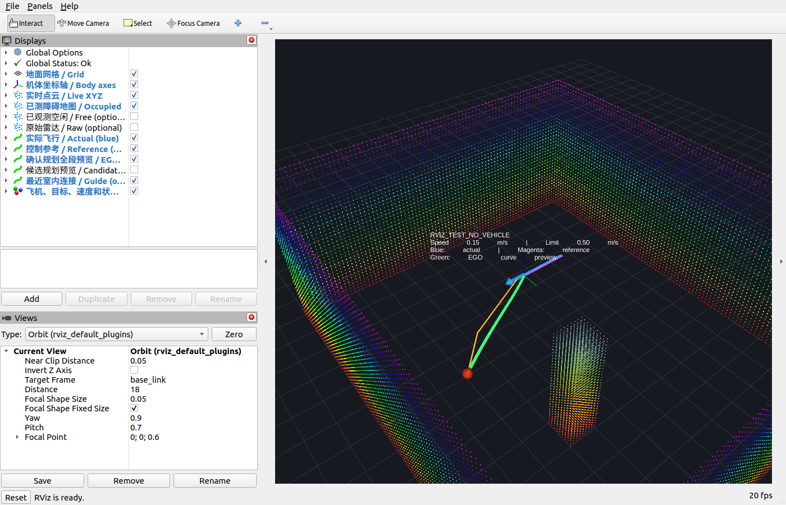

# 未知环境单机仿真任务

本工作空间使用 **PX4 仿真定位＋ROS 2 Humble＋Gazebo Harmonic＋GanYu 控制器**，完成仓库自主探索建图／巡飞，以及树林 A→B 穿越。支持 MID-360、Livox Avia、Ouster OS1-64 和未登记型号的实时 PointCloud2 输入。

**2026-11-16 运行验收完成：30/30。** 两任务×三雷达×三组初始航向的18组完整飞行全部通过当前交付版本核验；四类物理故障、17项点云接口、实际OS1稀疏回放及22份录包核验通过。本次文档复核另行重新执行版本审计，结果 `complete=true`、`issues=[]`。

- 正常飞行：零障碍碰撞，最小实测间距约 **1.215 m**，单次飞行最大跟踪RMSE **0.0823 m**，最大航点误差 **0.213 m**。
- 仓库：9组均完成探索、保存地图、至少四点巡飞、返航降落；保存地图覆盖率 **98.05%～99.82%**。
- 树林：9组均完成80 m目标航程并降落；观测缓存400000、原生环形缓存400000／701784，容量保持固定。
- 三组条件为同一场景的 **0°／+45°／−45°初始航向**。多个地图种子、真实硬件、无GPS定位和跨重启重定位未在本轮验证；ODIN1已排除。

完整结果见 [六种组合及逐次证据](../log/manual_acceptance/20261116_040954_1261551_scoring_lifecycle/results/README.md)、[原批机器核验](../log/manual_acceptance/20261116_040954_1261551_scoring_lifecycle/audit.json) 和 [本次独立复核](../log/release_review_20261116/audit.json)。范围见 [确认方案](../docs/autonomy_plan.md)，通信约定见 [接口说明](../docs/autonomy_interfaces.md)，开发修复历史见 [实施记录](../docs/autonomy_implementation.md)。

## 1. 环境与构建

以下命令均在工作空间根目录执行：

```bash
cd /home/ake/SJTU/适配终端/gazebo_sim
```

本机沿用已有PX4 SITL、MicroXRCEAgent、ROS/Gazebo桥和RGL环境。RGL需要兼容的NVIDIA RTX显卡与驱动；Python/ROS入口使用 `/usr/bin/python3`，独立几何评分使用专用虚拟环境。

首次准备或源码变更后运行：

```bash
./scripts/setup_autonomy_lidars.sh
./scripts/setup_autonomy_evaluation.sh
./scripts/build_autonomy.sh
./scripts/build_ego_backends.sh all
```

主工程安装到根目录 `install/`，构建缓存位于 `~/.cache/gazebo_sim_autonomy/build`。EGO-Swarm和EGO-v2独立安装到 `~/.cache/gazebo_ego_swarm`、`~/.cache/gazebo_ego_v2`，入口只加载当前后端，避免同名包冲突。单独修改某个后端时可构建 `swarm` 或 `v2`。

PX4默认目录为 `~/PX4-Autopilot`，可用 `PX4_DIR` 指定。RGL默认目录为 `~/.local/opt/gazebo_sim_mid360_rgl-v0.2.0`，可用 `MID360_RGL_DIR` 指定。地图资源已固定保存在本地；首次安装缺少RGL或评分依赖时需要网络。原键盘和A*入口继续可用，见 [工作空间README](../README.md)。

## 调整飞行速度

任务的航路速度上限在以下源码配置中，单位为m/s：

- 仓库探索／巡飞：[warehouse.yaml](config/warehouse.yaml) 的 `autonomy.ros__parameters.max_velocity`。
- 树林穿越：[forest.yaml](config/forest.yaml) 的同名参数。

目前两者均为 **0.5**。例如把要运行的任务改为：

```yaml
max_velocity: 0.3
```

然后启动新的场景／任务会话即可，无需重新编译；入口会把源码目录的配置复制到本次 `configuration/`，不要只修改 `install/` 下的副本。运行中该参数不热更新，直接 `ros2 param set` 不会修改当前控制变量。

这是上限，不是恒定巡航速度：转弯、观察、避障和制动会更慢。原生EGO已经订阅任务的速度请求；Swarm按三轴约束预留余量，v2按向量速度预留20%余量，通常无需再改 `manager/max_vel` 等初始值。观测不足还会逐步降低上限，现有恢复逻辑最低采用 **0.18 m/s**，因此当前配置请保持 **0.18～1.0 m/s**；可从0.3或已验收的0.5开始。不要用电机转速、推力或GanYu增益调巡航速度。

起飞／降落保留原有时间曲线；此参数主要调整EGO航路和观察机动。0.5为本轮30/30验收使用的任务设置，改速度后的结果应单独验证，原回执不能代替新参数的飞行证据。

## RViz可视化

场景和任务启动后，在**第三个终端**运行：

```bash
./view_autonomy.sh
```

三终端使用相同的 `ROS_DOMAIN_ID`。该入口直接使用源码配置，不需要重新编译。它启动RViz和独立显示适配器，不启动Gazebo、PX4、GanYu，不解锁，也不发布目标、控制、TF或规划反馈；关闭RViz或按Ctrl+C只关闭本显示入口。

默认固定坐标系 `odom`，视角跟随 `base_link`。左侧可勾选各层：

- 实时点云：`/autonomy/cloud`，按高度着色；与MID-360、Avia、OS1-64或外部PointCloud2共用同一接口。
- 已测障碍：`/autonomy/occupied`，橙红色。已观测空闲和原始雷达点云默认关闭，可按需启用。
- 实际飞行轨迹：蓝色；控制器实际采样参考：紫色。
- 已确认的EGO原生规划曲线：绿色，仅作全段预览，执行器仍逐段检查观测、有效期和制动空间。
- 候选规划：灰色，默认关闭，可能尚未通过执行检查；不把候选当成已确认轨迹。
- 最近一次室内连接引导：橙色；树林不发布这条全局连接，不影响本地EGO曲线显示。
- 飞机箭头、当前目标、任务阶段、实际速度和当前任务速度上限。

显示轨迹只在 `/autonomy/visualization/*` 下发布，直接采样原始B样条／五次多项式，不重新拟合。历史轨迹最多保留3000点，过旧部分滚动淘汰；制动清除确认曲线，时钟回拨清空旧时域显示，仿真暂停会显示提示。原始点云不要求intensity或ring。

配置文件为 [autonomy.rviz](config/autonomy.rviz)。鼠标左键旋转、中键平移、滚轮缩放；Views中的Target Frame可切换为 `odom` 查看固定视角。界面等待数据时，先确认场景／任务已经启动、ROS域相同，且 `/clock`、`/autonomy/odom`、`/autonomy/cloud`正常；空闲层或室内连接暂时没有数据不等于飞行失败。

默认20 FPS、点云队列1，空闲体素和原始云默认关闭以降低远程桌面负担。高密度OS1显示吃紧时可临时关闭已测障碍或降低RViz帧率，不修改导航输入。纯终端只启动显示适配器可用 `./view_autonomy.sh --no-rviz`，此模式不会弹出界面。

下面为隔离测试点云的真实RViz截图，标有 `RVIZ_TEST_NO_VEHICLE`；仅验证界面，未启动飞机，也不计新增飞行验收。



## 2. 仓库：探索、保存地图、巡飞

终端1启动场景：

```bash
./run_autonomy_scene.sh --world warehouse --lidar mid360
```

等待出现 `verified; vehicle remains unarmed.`，保持终端1运行，在终端2启动任务：

```bash
./run_autonomy.sh --task explore --start --no-record
```

任务依次完成起飞、从空白地图探索、保存OctoMap、选择并验证至少四个不同位置／高度的巡检点、巡飞、返回和降落。`--start`允许自动起飞；不加它只运行感知和预览。需要保留固定输出路径时加 `--output /绝对路径/新的任务目录`。

三种雷达只需在场景端更换 `--lidar mid360|avia|os1_64`，任务命令相同。`--headless`关闭场景界面。任务输出中的 `warehouse.bt` 为保存地图，`patrol_points.json` 为实际巡检点；地图保留本次会话的定位原点。

在同一探索会话中手动切换至巡飞：

```bash
./run_map_patrol.sh
./run_map_patrol.sh --points /绝对路径/points.json
```

两条命令择一执行。自定义文件为米制ENU坐标数组，至少四点，例如 `[[0,0,4.1],[2,0,4.5],[2,-2,5.1],[0,-2,5.5]]`；这只是格式示例，须按实际已建地图选择目标。入口检查点数、间距、高度差、观测净空和连接路径，不会启动第二套控制器。

自动目标后续被新观测阻断时，系统先制动，最多重新生成整组目标两次，并保存旧版 `patrol_points.revisionN.json`；新一组从零计数。用户指定点不会被自动改写，目标被已测障碍阻断时报告 `requested_patrol_target_blocked`。

探索停止原因与覆盖率分别记录。前沿耗尽、低观测增益或超时本身都不证明全图完成；探索预算超时仍判任务未完成。覆盖率由独立评测直接查询保存地图，不反馈给导航。

## 3. 树林：局部感知A→B

终端1启动长树林场景：

```bash
./run_autonomy_scene.sh --world forest_long --lidar avia
```

等待数据验证就绪，在终端2运行：

```bash
./run_autonomy.sh --task forest --start --no-record
```

默认目标为ENU `(80,0,1.8)`，允许目标位于当前滚动窗口之外。飞机只获取自身状态、B点和实时点云，在树间绕障，到达后悬停确认并降落，不建立或保存全局OctoMap。树木坐标、碰撞地图和评分通道不输入规划器。

可更换三种雷达；`forest_original`保留官方短树林。自定义目标示例：

```bash
./run_autonomy.sh --task forest --goal 60 2 1.8 --start --no-record
```

目标应在场景可达范围和安全降落区内。仅验证模型、点云及回波而不飞行：

```bash
./run_autonomy_scene.sh --world warehouse --lidar os1_64 --headless --check
```

每次完整任务使用新的仿真会话，不复用前一轮地图。

## 4. 未登记雷达接入

**不需要登记型号，也不必填写FOV、盲区、量程或线数，不需要重新编译。** 外部雷达需提供：

- `sensor_msgs/msg/PointCloud2`，包含米制 `x/y/z`、真实采样时间和点云坐标系。
- 采样时刻可查询的传感器到机体TF，测量原点明确。
- 与该点云处于同一运动、场景和时间域的PX4状态；仿真使用一致的 `/clock`。

驱动已有正确TF时直接使用。适配器支持字段重排、FLOAT32／FLOAT64混合、大小端和行填充，过滤无效点并按空间降采样，不要求 `intensity`、`ring` 或逐点时间。

在相同ROS域中发布点云，先不加 `--start`核查数据：

```bash
./run_autonomy.sh --task forest --cloud-topic /external/points --mass 2.39
```

`--mass`是飞机总质量。通过本机场景入口启动的飞机会自动读取载荷质量；外部飞机需要明确提供，不能用雷达型号代替质量。检查后结束预览，再使用新的任务输出目录加 `--start`启动。仓库模式改为 `--task explore`。

点云XYZ已转换至 `odom`／世界坐标时，需要额外指定真实测量原点：

```bash
./run_autonomy.sh --task forest --cloud-topic /external/world_points \
  --sensor-origin-frame external_lidar --mass 2.39
```

世界坐标frame不能代替传感器原点。未知安装外参和错误时间关系无法从PointCloud2可靠恢复；累计地图也不能冒充单帧测量云。真实雷达观测必须与受控飞机的实际状态对应。

没有回波的方向保持未知，不从点云包络推断硬件FOV、从最近点推断盲区，或把计算窗口视为量程。窗口外有效射线可以更新沿途空间，截断位置不生成假障碍。观测不足时降速重规划、转向或在已测空间换观察点，无法保持制动空间时停车并报告原因。

## 5. 地图、算法与控制

- 仓库：AWS Small Warehouse完整带屋顶版本，约14×21 m。OctoMap＋三维Frontier＋EGO-Swarm原生B样条；固定栅格缓存24×32×12 m、分辨率0.2 m，障碍由传感器在线获取。
- 树林：PX4松树／橡树资源，保留原地图并制作80 m目标航程版本。EGO-v2 `main_ws`原生环形地图＋MINCO五次多项式；窗口20×20×8 m、分辨率0.2 m。封路故障使用独立的 `forest_blocked.sdf`。
- GanYu：200 Hz原平移控制律，直接跟踪原轨迹求出的p/v/a/jerk及航向／航向角速度，不重新拟合成七次曲线。坐标变换、时间、轨迹确认与撤销规则见 [接口说明](../docs/autonomy_interfaces.md)。
- 雷达模型：MID-360、前向Livox Avia、旋转64线Ouster OS1-64，仿真端分别选择RGL预设、载荷和安装TF；导航不接收其扫描能力参数。三种总质量约2.3903／2.6233／2.5503 kg。

仓库固定提交 `ee0af733315e78432408c3cd98d378ecee5f767c`，PX4树林资源 `e05f4312d3f28aa621157610584a4870406cb6d3`；EGO-Swarm `23a8d5a191711dd65633df689bd00f55d4dea8f9`，EGO-v2 `9d85475ea7b9bf5c112cf7c3c3d0d3f9e96d9010`。本机PX4提交为 `96ca8d5ac263982fab9da32a56b677d52a63ec97`。来源、许可证与版本见 [UPSTREAMS.json](../third_party/UPSTREAMS.json)、[资源说明](../assets/vendor/README.md) 和 [上游修改](../docs/ego_upstream_changes.md)。

RGL使用可视射线表面。仓库部分碰撞外壳比可视网格更外扩，因此保留外观、布局和碰撞几何，同时增加透明射线表面使回波与物理表面一致，清单见 [RGL_COLLISION_SURFACES.json](../assets/vendor/RGL_COLLISION_SURFACES.json)。每次矩阵起飞前独立验证回波，验证结果不传入导航。

## 6. 执行约束和故障处理

当前低速任务配置的速度上限为0.5 m/s，观测不足可请求0.18 m/s重新规划；外部参考硬上限为1 m/s、0.7 m/s²、1.5 m/s³。速度降低由规划器重规划实现，不单独裁剪原轨迹参考。

起降区声明半径1.3 m的已知净空，仓库高4.8 m、树林高3 m。这是场景条件，不是雷达能力。仓库起飞3.8 m、执行高度3.7～5.7 m；树林起飞1.8 m、硬执行高度1.5～2.3 m，原生软高度范围1.6～2.2 m。仓库模型出生高度0.10 m，避免脚架穿入原地板，随后未解锁落稳。

独立间距门槛为0.65 m；执行检查还要求机体扫掠包络和完整制动曲线有真实空闲观测支撑。X500包络半轴0.50／0.50／0.35 m，检查覆盖三种载荷和旋翼全转角。仓库增加0.25 m误差余量；树林增加0.15 m误差和一格0.20 m停车余量，原生膨胀半径1.00 m，并补齐体素几何误差。相关参数见 [warehouse.yaml](config/warehouse.yaml)、[forest.yaml](config/forest.yaml)、[ego_swarm.yaml](config/ego_swarm.yaml)、[ego_v2.yaml](config/ego_v2.yaml)。

轨迹需经确认才能执行，数据／TF失效、轨迹过期或制动条件不满足时进入制动／悬停。仿真暂停不会推进轨迹或累计仿真超时；时钟回拨使旧地图、TF和轨迹失效，需要重新建立一致会话。人工退出Offboard后停止输出，不自主抢回控制权，同一架飞机始终只有一套控制输出。

仓库探索预算2400 s、任务预算3600 s；树林任务预算1500 s。独立120 s无进展保护继续生效，扫描或往返不会被当作到达成功。起飞数据等待保留整次起飞计时；无抬升／未到起飞高度及时报告失败。

正常任务返回安全区降落；故障悬停不自动等同于降落。在实际安全的降落位置可由人工请求降落：

```bash
source /opt/ros/humble/setup.bash
source install/setup.bash
ros2 topic pub --once /ganyu/keyboard std_msgs/msg/String '{data: "l"}'
```

执行前核对当前控制状态和地面条件，避免与另一套键盘或航点控制器并行输出。

## 7. 验收、结果和复核

当前批次为 `log/manual_acceptance/20261116_040954_1261551_scoring_lifecycle`。其30项构成为五项软件／接口、18组正常飞行、四类物理故障、三项最终核验。本批新执行剩余12步，复用13组已核验飞行与五项前置检查；最终没有待复飞项目。

```bash
./run_acceptance.sh status
./run_acceptance.sh plan
```

当前验收已完成，默认 `./run_acceptance.sh`不重飞。仅在需要独立重新执行全部验收时使用 `./run_acceptance.sh --fresh`；会自动启动22次物理试验并增加录包。失败续跑、单独前置检查和停止方式见 [手动验收指南](../docs/manual_acceptance.md)。

正常任务同时满足：任务成功并降落、零障碍碰撞、间距≥0.65 m、航点误差≤0.25 m、跟踪RMSE≤0.15 m；仓库地图覆盖≥90%，树林缓存容量固定。四类故障另外检查：

- 点云暂停／状态暂停：及时制动停车，数据恢复后重新验证，再继续完成任务。
- 人工退出Offboard：停止角速度／推力接管；本次退出后新增角速度消息为0。
- 封路：受控停车并明确报告失败，不把失败悬停算正常任务成功。

软件回归为任务17项、GanYu6项和索引1项；点云接口17项，实际OS1 64→16回放1项。接口、回放及故障不计入正常18组。保存的 [六组合结果](../log/manual_acceptance/20261116_040954_1261551_scoring_lifecycle/results/README.md) 包含每组耗时、路径、停顿、间距、误差、覆盖率及逐次证据。

独立重新审计当前结果，不启动仿真：

```bash
source /opt/ros/humble/setup.bash
source install/setup.bash
/usr/bin/python3 scripts/audit_autonomy_release.py \
  --matrix log/matrix/20261111_153325 \
  --faults log/manual_acceptance/latest/faults \
  --interfaces log/manual_acceptance/latest/interfaces \
  --os1-replay log/manual_acceptance/latest/os1_replay \
  --regressions log/manual_acceptance/latest/regressions \
  --output /tmp/gazebo_sim_autonomy_audit.json
```

返回0且 `complete=true`、`issues=[]`表示当前已登记版本的全部运行证据有效。只看历史成功或终端 `FINISH 0`不足以代替版本、场景、录包和评分检查。

## 8. 日志、地图和回放

单独运行的场景在 `log/autonomy_scene/`，任务在 `log/autonomy/`；矩阵在每次试验的 `mission/` 下保存完整资料。已有试验目录拒绝覆盖。常用文件：

- `run.json`、`configuration/`：实际参数、场景和二进制／源码指纹。
- `result.json`、`events.jsonl`：任务结果、阶段变化、拒绝／制动／重规划和结束原因。
- `warehouse.bt`、`patrol_points.json`：保存地图和当前巡检点，仅仓库任务生成。
- `evaluation/evaluation.json`、`truth.csv`：原独立评分与真值轨迹；真值不输入导航。
- `evaluation/evaluation.corrected.v3.json`：当前派生重评分，保留原件和工具SHA；审核时重新计算验证。旧评分与旧修正版不覆盖。
- `bag/`、`recording_finalization.json`、`bag/replay_verification.json`：点云、状态、轨迹、参考及关闭后压缩／回放验证。
- `autonomy.log`、`ego.log`、`trajectory_bridge.log`、`ganyu.log`：分别定位任务、原生规划、接入桥和控制器问题。

航点按对应巡检代次／当前目标核算，探索路过不算巡检到达。起飞／起飞数据等待／降落不计航路净空间距；观察等待、路线等待和失败悬停仍计入，真实碰撞不会被重评分删除。覆盖率查询保存的OctoMap；资源统计只涵盖导航会话，不包含Gazebo、PX4和评分器。

录包按512 MiB分片，关闭后无损zstd压缩并验证解压SHA。22份当前验收录包均完成SQLite完整性、话题计数及首尾消息反序列化检查；这不等于逐条检查全部点云的物理语义。可在新临时目录独立复核：

```bash
/usr/bin/python3 scripts/verify_closed_recording.py /绝对路径/已关闭任务/bag --require-flight --reuse-verified
```

该命令需先加载上面的ROS环境；故障短任务按原故障验收口径验证，不强求完整航路话题。

感知回放使用独立空闲ROS域，不启动GanYu或起飞：

```bash
/usr/bin/python3 scripts/preview_autonomy_recording.py \
  /绝对路径/已关闭任务/bag --task explore \
  --output /绝对路径/新的回放目录 --domain 230 --seconds 5
```

树林改为 `--task forest`，自定义点云加 `--cloud-topic`，世界云加 `--sensor-origin-frame`。使用录制的 `/clock`，不要另外用存储接收时间生成时钟。回放结果不算重新飞行。

## 9. 存储和适用范围

普通验收步骤要求至少30 GiB可用空间，OS1-64仓库步骤要求60 GiB；长录包压缩期间还需要原件与临时空间。任务结束后等待录包收尾，再进行回放或清理。清理只删除已有同配置／同结果、更新且可核验替代的旧录包，保留最新正常／失败记录、地图、评分和队列；不要删除活跃录包或固定资源。清理清单保存在 `log/cleanup_*/`，部分早期录包已删除，130份开发结果不等于130份原始点云均保留。

本次结论适用于固定仓库和长树林、三种扫描预设、三组初始航向、PX4仿真定位和低速静态环境。树林已测障碍保留到移出滚动窗口，未验证动态障碍移走后的即时清除；地图跨重启重定位、真实硬件飞行、雷达里程计、多地图种子和ODIN1均不在本轮验收范围。新雷达可无需能力先验进入流程，能否完成任务取决于实际可获取的安全观测。
